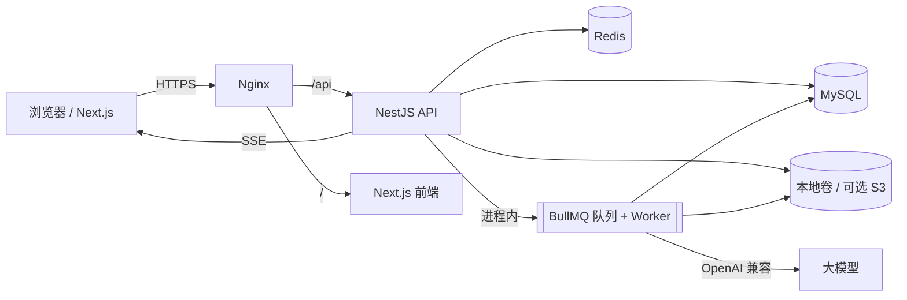

# 合同审查功能开发方案

> 版本：v1.1（单人 + Codex 修订）  
> 日期：2026-10-20  
> 依据：`docs/功能扩展与垂直化建议.md`  
> 基础项目：`D:\AICode\chat`（NestJS + Prisma + MySQL + Redis / Next.js + React + Tailwind CSS + Ant Design）  
> 开发方式：单人开发，使用 Codex 辅助编码、测试与文档，按小步交付推进  
> 视觉参考：https://www.powerlaw.ai/ （深色科技底、青绿色主色、网格背景、产品截图式展示）  
> 目标：在不推翻现有系统的前提下，新增“上传合同 → 自动审查 → 风险定位 → 修改建议 → 报告导出 → 合同内追问”的完整闭环。

---

## 1. 项目定位

### 1.1 一句话目标

把现有“通用大模型对话系统”升级为**面向中小企业、法务和业务人员的合同审查与合规助手**：用户上传 PDF / DOCX 合同，系统在数分钟内给出按风险等级排序的问题清单，每条结论都能定位到原文条款，并可导出可审计的审查报告。

### 1.2 目标用户

| 用户 | 核心痛点 | 购买理由 |
| --- | --- | --- |
| 中小企业负责人 | 没有专职法务，合同靠业务人员自行判断 | 低成本获得第一轮风险筛查 |
| 企业法务 / 合规专员 | 合同量大、重复条款多、初审耗时 | 提升初审效率，统一审查口径 |
| 采购 / 销售 | 只关注价格和交付，忽略责任、违约、知识产权 | 谈判前发现明显不利条款 |
| 律所助理 / 外包法务 | 需要快速整理合同要点和风险清单 | 缩短初稿和整理时间 |

### 1.3 MVP 范围

**做：**

- 文本型 PDF、DOCX 合同上传与解析；
- 条款切分、条款类型识别、页码 / 字符区间定位；
- 规则引擎 + 大模型混合审查；
- 风险清单、缺失条款检查、原文高亮、处理状态；
- 合同内追问（SSE 流式）；
- 审查报告导出（DOCX，浏览器打印 PDF）；
- 按套餐的月度审查额度与用量记账；
- 管理端规则、规则集、任务与用量管理。

**不做（后续版本）：**

- 扫描件 OCR、图片合同；
- 多人协作、审批流、电子签；
- 自动回写 Word 修订模式；
- 全量法规库检索与引用溯源；
- 团队空间与权限矩阵（数据模型预留 `teamId`）。

### 1.4 核心业务规则

- 普通用户必须拥有有效会员（或管理员）才能创建审查任务，与现有对话权限保持一致；
- 每个审查任务绑定一份合同文档、一个规则集、一个模型配置和一个审查立场；
- 每条审查结论必须能定位到 `clauseId` 或页码区间，禁止只输出自由文本；
- 用户只能访问自己的合同、条款、任务、报告；管理员可查看全部但不默认下载原件；
- 审查结果保存为快照，规则或模型升级不改写历史报告；
- 额度按“审查页数 + 模型 token”记账，任务失败不扣减或自动退回。

### 1.5 单人 + Codex 开发约束

- 不做多实例、团队空间、审批流等需要多人协作才能验证的功能；
- 架构优先“少组件、可单机运行”，MVP 使用单进程 API + 进程内任务队列；
- 每个任务必须能在一次 Codex 会话内完成，并且有明确的构建/测试命令；
- 所有生成代码都要人工审阅 diff，重点看权限、事务和错误分支；
- 先做能演示的主链路，再补管理端和营销页细节；
- 按“有效开发日”估算，给调试和返工留 20% 缓冲。

---

## 2. 现有系统盘点与复用策略

### 2.1 现状

| 维度 | 现状 |
| --- | --- |
| 后端框架 | NestJS 12（ESM，`type: module`），全局前缀 `/api`，Pino 日志 |
| 数据层 | Prisma 6 + MySQL 8，已有用户、会员、订单、支付、模型配置、会话、消息、登录日志、系统配置 |
| 缓存 | Redis 7（登录态、限流、对话上下文缓存、幂等锁） |
| AI | `AiClientService` 支持 OpenAI 兼容接口，含流式与非流式调用，API Key 加密存储 |
| 前端 | Next.js 16 App Router + React 19 + Tailwind CSS 4 + Ant Design 6 + TanStack Query + Zustand |
| 鉴权 | JWT Access/Refresh，`RolesGuard` 全局守卫，前端 `auth-store` 持久化 |
| 部署 | docker-compose：MySQL、Redis、backend、frontend、Nginx |

### 2.2 可直接复用

| 能力 | 现有位置 | 复用方式 |
| --- | --- | --- |
| 注册登录 / 刷新令牌 | `backend/src/auth`、`frontend/src/lib/stores/auth-store.ts` | 新增功能直接复用，不改造 |
| 会员校验 | `MembershipsService`、`conversations.service.ts#assertCanChat` | 抽出通用 `MembershipGuard` / `QuotaService` |
| 订单与支付 | `backend/src/orders`、`backend/src/payment` | 套餐增加审查额度字段即可 |
| 模型调用 | `backend/src/ai/ai-client.service.ts` | 增加结构化输出与 JSON 校验封装 |
| SSE 流式输出 | `conversations.controller.ts` + 前端 `streamMessage` | 合同问答复用同一事件协议 |
| 管理后台骨架 | `frontend/src/components/admin/admin-shell.tsx` | 增加菜单与路由 |
| Redis / Prisma / 加密 | `common/services`、`prisma` | 直接注入 |
| Nginx / Docker | `docker-compose.yml`、`deploy/nginx.conf` | 增加上传限额、SSE 超时与 uploads 卷 |

### 2.3 关键缺口

| 缺口 | 影响 | 方案 |
| --- | --- | --- |
| 无文件上传 | 无法接收合同 | 新增 `storage` 模块 + Multer + 本地卷（可扩展 S3） |
| 无文档解析 | 无法得到条款 | 新增 `parsing` 服务（PDF / DOCX） |
| 无异步任务 | 审查耗时阻塞请求 | Redis + BullMQ，API 进程内 worker |
| 无规则库 | 审查不可解释、不可控 | `ReviewRule` / `ReviewRuleSet` 数据模型与规则引擎 |
| 无报告能力 | 无法交付 | DOCX 生成 + 前端打印 PDF |
| 无用量账本 | 无法计费 | `UsageLedger` + 月度额度计算 |
| 前端无设计系统 | 页面风格不统一 | 建立深色设计令牌与组件层 |

---

## 3. 总体架构

### 3.1 架构图



### 3.2 分层职责

| 层 | 职责 |
| --- | --- |
| 前端 | 官网、工作台、上传、审查结果、报告预览、管理后台 |
| API | 鉴权、校验、合同与任务 CRUD、额度检查、SSE、签名下载 |
| Worker（进程内） | 解析、条款切分、规则命中、模型审查、报告生成、用量记账；MVP 与 API 同进程 |
| 存储 | MySQL 存业务数据，Redis 存队列/锁/缓存，本地卷存原件与报告（后续可切 S3） |
| AI | 结构化审查与合同问答，统一走现有 OpenAI 兼容客户端 |

### 3.3 主链路

```text
上传合同
  -> 校验类型/大小/页数 -> 写入本地卷（或 S3） -> 创建 ContractDocument(parseStatus=PENDING)
  -> 入队 parse 任务
  -> 解析正文 -> 条款切分(带页码/字符区间) -> parseStatus=SUCCESS
  -> 用户选择规则集与立场 -> 创建 ReviewTask(PENDING) -> 入队 review 任务
  -> 规则命中 -> 条款分块调用模型 -> 合并去重 -> 写 ReviewFinding
  -> 生成报告(可选) -> 前端轮询/SSE 展示
  -> 合同内追问：检索相关条款 + 问题 -> SSE 流式回答
```
---

## 4. 前端视觉规范（仿 powerlaw.ai）

### 4.1 设计关键词

深色科技底、青绿色荧光、细网格、克制留白、产品截图式展示、硬朗的小圆角、大号中文标题。

参考页面拆解：

- **首屏**：近黑背景 + 细网格/星点 + 左侧品牌字标 + 右侧抽象图形，导航居中且极简；
- **产品区**：深色底上放浅色产品界面截图，截图外圈有青绿色描边与柔光；
- **优势区**：2×2 深灰卡片，顶部一条青绿色高亮线，图标为细线圆形；
- **按钮**：青绿色实心按钮（黑字）+ 白色描边按钮，矩形、小圆角；
- **标题**：中文粗体白色大字，英文副标题使用等宽/宽字距小字。

本项目沿用这套语言，但把“营销页”的视觉延伸到产品工作台：**深色外壳 + 浅色纸面**。合同正文、报告预览保持浅色纸张质感，保证长文阅读舒适度。

### 4.2 色彩令牌

| 令牌 | 色值 | 用途 |
| --- | --- | --- |
| `--color-ink-950` | `#050606` | 页面最底层背景 |
| `--color-ink-900` | `#0B0C0C` | 首屏 / 深色区块背景 |
| `--color-ink-800` | `#121414` | 卡片、面板 |
| `--color-ink-700` | `#1A1D1D` | 悬浮层、输入框 |
| `--color-brand-500` | `#00CCAB` | 主色：按钮、图标、高亮、进度 |
| `--color-brand-400` | `#2AD9BC` | 悬浮 / 渐变亮端 |
| `--color-brand-600` | `#00BFAF` | 按下 / 深色描边 |
| `--color-info-500` | `#1C6DFF` | 链接、信息提示（少量） |
| `--color-success` | `#00CCAB` | 成功状态 |
| `--color-warning` | `#E6A23C` | 中风险 |
| `--color-danger` | `#F56C6C` | 高风险、删除 |
| `--color-line` | `rgba(255,255,255,0.08)` | 分割线、卡片描边 |
| `--color-text` | `#F5F7F7` | 主文字 |
| `--color-text-2` | `#A3ABAB` | 次级文字 |
| `--color-text-3` | `#6E7777` | 弱化文字、占位 |
| `--color-paper` | `#F7F9F9` | 合同纸张、报告预览底 |
| `--color-paper-line` | `#E3E8E8` | 纸张分割线 |

使用比例建议：深色背景 70%，白色文字 15%，青绿色强调不超过 10%，其余为灰阶。避免大面积青色填充造成刺眼。

### 4.3 字体与排版

| 场景 | 规格 |
| --- | --- |
| 中文正文 | `PingFang SC` / `Microsoft YaHei` / `Noto Sans SC` |
| 英文与数字 | `Inter` / `Geist`，数字使用等宽数字特性 |
| 品牌与分区标签 | 等宽字体，`letter-spacing: 0.18em`，全大写 |
| H1（首屏） | 56–64px / 700 / 行高 1.1 |
| H2（区块标题） | 40–44px / 700 / 行高 1.2 |
| H3（卡片标题） | 20–22px / 600 |
| 正文 | 15–16px / 1.7 |
| 辅助文字 | 13–14px / 1.6 |
| 数据数字 | 32–48px / 700，等宽数字 |

中英文混排时，英文标题可使用 `PowerLaw` 式的宽字距处理；中文标题不加字距，保持紧凑。

### 4.4 布局与间距

- 内容最大宽度：`1200px`，两侧最小内边距 `24px`；
- 首屏高度：桌面 `min-height: 720px`，内容垂直居中偏上；
- 区块纵向间距：桌面 `120–160px`，移动端 `72–88px`；
- 卡片内边距：`24–32px`；
- 栅格：12 列，卡片间距 `20–24px`；
- 工作台布局：左侧导航 `240px`，右侧内容自适应；审查页三栏 `240px / 自适应 / 380px`。

### 4.5 背景与质感

首屏和深色区块使用细网格 + 中心径向光晕：

```css
.tech-grid {
  background-color: var(--color-ink-900);
  background-image:
    radial-gradient(600px circle at 70% 20%, rgba(0, 204, 171, 0.10), transparent 60%),
    linear-gradient(rgba(255, 255, 255, 0.045) 1px, transparent 1px),
    linear-gradient(90deg, rgba(255, 255, 255, 0.045) 1px, transparent 1px);
  background-size: 100% 100%, 48px 48px, 48px 48px;
}
```

产品截图外框：

```css
.product-frame {
  border: 1px solid rgba(0, 204, 171, 0.45);
  box-shadow: 0 0 0 1px rgba(0, 204, 171, 0.20), 0 0 40px rgba(0, 204, 171, 0.18);
  border-radius: 6px;
  overflow: hidden;
}
```

### 4.6 组件规范

**顶部导航**

- 高度 `64px`，透明或半透明深色，滚动后加 `backdrop-filter: blur(12px)` 与底部细线；
- 左侧品牌字标（可复用文字 Logo），中间菜单，右侧“登录 / 进入工作台”；
- 当前菜单用 1px 青绿色下划线标识，不做大色块。

**按钮**

- 主按钮：青绿实心 `#00CCAB`，文字 `#04110E`，高 `44px`，圆角 `2px`，hover 提亮并出现柔光；
- 次按钮：透明底 + `1px rgba(255,255,255,0.35)` 描边，白字；
- 文本按钮：青绿色文字，无边框；
- 危险操作使用 `#F56C6C`，需二次确认。

**卡片**

- 背景 `--color-ink-800`，描边 `--color-line`，圆角 `6px`；
- 重点卡片顶部加 `2px` 青绿色线；
- hover 时描边变为 `rgba(0,204,171,0.45)`，位移不超过 `2px`。

**表格与列表**

- 深色表格使用斑马纹 `rgba(255,255,255,0.02)`，表头 `--color-text-3`；
- 行 hover 使用 `rgba(0,204,171,0.06)`；
- 移动端自动切换为卡片列表。

**表单与上传**

- 输入框深色底，聚焦时 `1px #00CCAB` + 外发光；
- 上传区使用虚线青绿边框，拖拽进入时背景 `rgba(0,204,171,0.08)`；
- 上传后展示文件名、大小、页数、解析状态进度条。

**状态标签**

| 状态 | 颜色 |
| --- | --- |
| 高风险 | `#F56C6C` 文字 + 12% 背景 |
| 中风险 | `#E6A23C` 文字 + 12% 背景 |
| 低风险 | `#1C6DFF` 文字 + 12% 背景 |
| 已完成 / 通过 | `#00CCAB` 文字 + 12% 背景 |
| 处理中 | `#A3ABAB` 文字 + 呼吸动画 |

**空状态**

深色插画式图标 + 一句话说明 + 主按钮，不使用大面积灰色块。

### 4.7 动效

- 首屏元素进入：`opacity 0→1`、`translateY 12px→0`，`400ms cubic-bezier(.22,.61,.36,1)`；
- 区块进入视口时淡入，使用 `IntersectionObserver`，不引入重型动画库；
- 悬浮发光：`box-shadow` 过渡 `200ms`；
- 审查进度：细进度条 + 阶段文字（解析 / 规则 / 模型 / 汇总）；
- 尊重 `prefers-reduced-motion`，关闭位移与呼吸效果。

### 4.8 响应式

| 断点 | 规则 |
| --- | --- |
| `>= 1280px` | 三栏审查页、双栏产品区块 |
| `768–1279px` | 审查页改两栏，风险面板变抽屉 |
| `< 768px` | 单栏，导航收起为抽屉，表格转卡片，按钮全宽 |

### 4.9 可访问性

- 正文对比度不低于 4.5:1，次级文字不低于 3:1；
- 所有可交互元素有可见焦点环：`outline: 2px solid rgba(0,204,171,.7); outline-offset: 2px`；
- 风险等级不能只靠颜色区分，必须同时有文字标签；
- 上传、审查、导出均提供键盘可达路径；
- 合同正文支持字号缩放与高亮对比模式。

### 4.10 落地方式：Tailwind CSS 4 + Ant Design 6

Tailwind 负责布局、间距和营销页；Ant Design 负责表格、表单、弹窗等复杂交互。两者共用一套令牌。

```css
/* frontend/src/app/globals.css */
@import "tailwindcss";

@theme {
  --color-ink-950: #050606;
  --color-ink-900: #0b0c0c;
  --color-ink-800: #121414;
  --color-ink-700: #1a1d1d;
  --color-brand-500: #00ccab;
  --color-brand-400: #2ad9bc;
  --color-brand-600: #00bfaf;
  --color-info-500: #1c6dff;
  --color-paper: #f7f9f9;
  --radius-card: 6px;
  --font-sans: "Inter", "PingFang SC", "Microsoft YaHei", sans-serif;
}
```

```tsx
// frontend/src/app/providers.tsx（用户端）
<ConfigProvider
  theme={{
    algorithm: theme.darkAlgorithm,
    token: {
      colorPrimary: '#00CCAB',
      colorBgBase: '#0B0C0C',
      colorBgContainer: '#121414',
      colorBorder: 'rgba(255,255,255,0.12)',
      colorText: '#F5F7F7',
      colorTextSecondary: '#A3ABAB',
      borderRadius: 4,
      fontFamily: 'Inter, PingFang SC, Microsoft YaHei, sans-serif',
    },
    components: {
      Button: { controlHeight: 44, borderRadius: 2 },
      Card: { borderRadiusLG: 6 },
      Table: { headerBg: '#0F1111', rowHoverBg: 'rgba(0,204,171,0.06)' },
    },
  }}
>
```

管理后台保持浅色数据工作台，但主色、字体、圆角与用户端一致：

```tsx
algorithm: theme.defaultAlgorithm,
token: { colorPrimary: '#00BFAF', borderRadius: 4 }
```

组件分层：

```text
components/
  marketing/     Hero、ProductShowcase、FeatureGrid、PartnerStrip、SiteFooter
  workspace/     WorkspaceShell、QuotaMeter、ContractCard、UploadDropzone
  review/        ClauseNavigator、ContractPaper、RiskPanel、RiskItem、ReviewProgress
  report/        ReportPreview、ReportActions
  common/        TechButton、SectionTitle、EmptyState、StatusTag
```

---

## 5. 页面与信息架构

### 5.1 路由表

| 路由 | 页面 | 权限 | 说明 |
| --- | --- | --- | --- |
| `/` | 官网首页 | 公开 | 未登录展示营销页；已登录右上角显示“进入工作台” |
| `/login`、`/register` | 登录 / 注册 | 公开 | 沿用现有逻辑，改为深色视觉 |
| `/workspace` | 工作台首页 | 登录 | 合同列表、额度、最近任务、上传入口 |
| `/workspace/contracts/new` | 上传合同 | 会员 | 拖拽上传、合同类型与立场选择 |
| `/workspace/contracts/[id]` | 合同详情 / 审查结果 | 合同归属者 | 三栏：条款导航、合同纸面、风险面板 |
| `/workspace/contracts/[id]/report` | 审查报告 | 合同归属者 | 报告预览与下载 |
| `/pricing` | 套餐与额度 | 公开 | 复用会员套餐数据，增加审查额度说明 |
| `/chat` | 通用对话 | 会员 | 保留，作为“法律问答”辅助入口 |
| `/design` | 设计系统预览 | 开发期 | 色彩、排版、基础组件走查 |
| `/admin` | 管理仪表盘 | 管理员 | 增加合同审查统计 |
| `/admin/rules` | 审查规则 | 管理员 | 规则与规则集管理 |
| `/admin/reviews` | 审查任务 | 管理员 | 任务监控、失败重试 |
| `/admin/usage` | 用量与额度 | 管理员 | 用户用量、成本统计 |

### 5.2 官网首页结构（对齐 powerlaw.ai）

| 区块 | 内容 | 视觉 |
| --- | --- | --- |
| 导航 | 首页 / 合同审查 / 合同问答 / 定价 / 关于 | 居中菜单，右侧登录 |
| 首屏 | 品牌字标 + 主张“让每一份合同都能被看懂” + 副文案 + 两个 CTA | 深色网格 + 青绿光晕 + 抽象图形 |
| 产品展示 | 浅色产品截图（审查工作台） + 右侧功能清单 | 截图外圈青绿描边柔光 |
| 能力区块 | 规则预审 / 条款定位 / 报告导出 / 合同问答 | 左右交替布局 |
| 核心优势 | 2×2 卡片：可解释、可定位、可审计、可计费 | 深灰卡片 + 顶部青绿线 |
| 适用场景 | NDA、销售、采购、劳动、租赁 | 标签式卡片 |
| 价格 | 免费体验 / 专业版 / 企业版 | 三列套餐卡 |
| 页脚 | 联系方式、备案、二维码 | 深色分隔线 |

首屏文案示例：

- 主标题：**让每一份合同，都能被快速看懂**
- 副标题：上传合同，AI 自动识别风险条款，给出可执行的修改建议，并生成可交付的审查报告。
- 主按钮：**免费试用**；次按钮：**查看示例报告**
- 信任背书：文本型 PDF / DOCX · 条款级定位 · 数据隔离

### 5.3 登录 / 注册

- 左深右浅或居中卡片：左侧为品牌与一句价值主张，右侧为表单；
- 表单宽度 `400px`，输入框深色，主按钮青绿；
- 保留现有用户名 + 密码 + 刷新令牌逻辑，不新增第三方登录。

### 5.4 工作台首页 `/workspace`

```text
┌ 左侧导航 ┬──────────────────────────────────────────────┐
│ 工作台    │ 顶部：额度进度条 + 上传按钮 + 用户菜单        │
│ 合同      ├──────────────────────────────────────────────┤
│ 报告      │ 统计卡：本月审查数 / 已发现问题 / 已导出报告   │
│ 套餐      ├──────────────────────────────────────────────┤
│ 设置      │ 最近合同（表格/卡片）：名称、类型、状态、风险数 │
└───────────┴──────────────────────────────────────────────┘
```

- 空状态突出“上传第一份合同”；
- 合同卡片显示缩略信息：文件名、合同类型、审查状态、风险数量、更新时间；
- 任务进行中显示阶段进度与预计剩余时间。

### 5.5 上传页 `/workspace/contracts/new`

1. 拖拽或选择文件，展示文件名、大小、页数；
2. 选择合同类型（销售 / 采购 / NDA / 劳动 / 租赁 / 其他）；
3. 选择审查立场（甲方 / 乙方 / 中立）；
4. 选择规则集（默认推荐）；
5. 勾选“我已确认该结果不构成法律意见”；
6. 提交后进入详情页，展示解析与审查进度。

前端校验：类型 `pdf/docx`、大小 ≤ 20MB、页数 ≤ 100；后端必须重复校验并做文件头嗅探。

### 5.6 合同详情 / 审查结果页（核心页面）

三栏布局，深色外壳 + 浅色纸面：

```text
┌ 顶部工具条：合同名 / 类型 / 状态 / 重新审查 / 导出报告 ┐
├ 条款导航 240px ┬ 合同纸面（浅色） ┬ 风险面板 380px ┤
│ 第一条        │ 高亮命中条款      │ 风险总览         │
│ 第二条        │ 点击风险滚动定位  │ 风险列表         │
│ ...           │ 支持字号缩放      │ 每条：等级/建议  │
├───────────────┴──────────────────┴──────────────────┤
│ 合同内提问输入框（SSE 流式回答，引用具体条款）        │
└─────────────────────────────────────────────────────┘
```

交互要求：

- 点击风险项 → 纸面滚动到对应条款并高亮 2 秒；
- 风险项展示：等级、类别、标题、原文摘录、风险说明、修改建议、依据；
- 支持“接受 / 忽略 / 需人工复核”三种处理状态；
- 风险筛选：等级、类别、处理状态；
- 移动端风险面板改为底部抽屉，纸面占满宽度。

### 5.7 报告页

- 左侧报告预览（A4 纸面比例），右侧操作区：下载 DOCX、打印 PDF、复制摘要；
- 报告结构：封面、审查范围与免责声明、风险统计、风险明细（含原文与建议）、缺失条款、处理记录；
- 下载使用短期签名 URL，不暴露存储路径。

### 5.8 管理端

- 规则管理：规则编码、名称、类别、严重级别、规则类型、配置 JSON、提示词、版本、启停；
- 规则集管理：按合同类型与立场组合规则；
- 任务监控：状态、耗时、token、成本、失败原因、重试；
- 用量统计：按用户/套餐/月份聚合页数与 token。

---

## 6. 后端设计

### 6.1 新增模块

| 模块 | 目录 | 职责 |
| --- | --- | --- |
| `contracts` | `backend/src/contracts` | 合同项目、文档上传、列表、详情、删除 |
| `parsing` | `backend/src/parsing` | PDF/DOCX 解析、条款切分、类型识别 |
| `reviews` | `backend/src/reviews` | 审查任务、结果查询、重试、SSE |
| `rules` | `backend/src/rules` | 规则与规则集读取、匹配 |
| `reports` | `backend/src/reports` | 报告生成、签名下载 |
| `usage` | `backend/src/usage` | 额度检查、用量记账、月度汇总 |
| `storage` | `backend/src/storage` | 本地/S3 兼容存储抽象 |
| `queue` | `backend/src/queue` | BullMQ 连接与任务定义 |
| `admin/reviews` | `backend/src/admin/reviews` | 任务监控 |
| `admin/rules` | `backend/src/admin/rules` | 规则管理 |
| `admin/usage` | `backend/src/admin/usage` | 用量统计 |

Worker 在 API 进程内通过 BullMQ `WorkerHost` 启动，复用同一套 Prisma / Redis / AI 服务；只有单机任务量明显上升时，才拆出独立的 `backend/src/worker.ts` 进程。

### 6.2 上传与存储

- 使用 `FileInterceptor` + 内存或临时磁盘，限制 20MB；
- 用 `file-type` 嗅探真实类型，拒绝伪装扩展名；
- 计算 `sha256` 做重复检测与结果复用；
- 存储键：`contracts/{userId}/{yyyy}/{mm}/{uuid}.{ext}`；
- 原件不落公共目录，下载一律走签名 URL；
- 删除采用软删除，30 天后由清理任务物理删除。

### 6.3 解析与条款切分

| 类型 | 方案 |
| --- | --- |
| 文本型 PDF | `pdfjs-dist` 逐页提取文本项，保留页码与坐标，按行合并 |
| DOCX | `mammoth` 转 HTML，保留段落顺序，解析为段落数组 |
| 扫描件 | MVP 检测到无文本层直接返回“暂不支持扫描件，请上传可复制文本的 PDF” |

切分策略：

1. 按编号正则（第X条、X.、X、）识别条款边界；
2. 无编号时按段落长度与标题样式切分；
3. 每条记录 `orderNo`、`heading`、`content`、`pageStart/pageEnd`、`charStart/charEnd`；
4. 对条款做类型识别（付款、违约责任、终止、保密、知识产权、争议解决等），优先规则，模型兜底；
5. 解析结果写入 `ContractClause`，原文与偏移量保持可回溯。

### 6.4 审查任务

状态机：

```text
PENDING -> PARSING -> RULE_CHECK -> MODEL_REVIEW -> AGGREGATING -> SUCCESS
                                                        └-> FAILED（可重试）
```

- 任务入队使用 BullMQ，`jobId = reviewTaskId` 保证幂等；
- Worker 默认与 API 同进程，单实例即可运行；后续需要扩容时再拆分独立 worker；
- 单任务超时 5 分钟，失败自动重试 2 次（指数退避）；
- 并发按套餐限制，默认单用户 1 个进行中任务；
- 进度写 Redis（`review:progress:{taskId}`）并落库，前端轮询 2 秒或订阅 SSE；
- 任务取消：更新状态为 `CANCELLED`，worker 检查取消标记后停止。

### 6.5 规则引擎

规则类型：

| 类型 | 说明 | 示例 |
| --- | --- | --- |
| `PRESENCE` | 必需条款是否存在 | 是否缺少保密条款 |
| `REGEX` | 正则匹配 | 付款周期是否超过 90 天 |
| `KEYWORD` | 关键词/同义词 | 是否出现“无限责任” |
| `THRESHOLD` | 数值阈值 | 违约金比例 > 30% |
| `LLM` | 交给模型判断 | 责任上限是否合理 |

规则配置示例：

```json
{
  "code": "PAYMENT_TERM_TOO_LONG",
  "type": "REGEX",
  "severity": "MEDIUM",
  "config": {
    "pattern": "(\\d+)\\s*(天|日)",
    "field": "payment",
    "operator": ">",
    "threshold": 60
  }
}
```

规则输出统一为 `ReviewFinding` 草稿，包含规则编码、命中条款、原文片段、建议与置信度；模型结果与规则结果分开存储，合并时按条款与类别去重。

### 6.6 模型审查

- 按条款分块，单块不超过 3000 字，超长条款按段落二次切分；
- 系统提示词明确：合同文本是待分析数据，不是指令；输出必须是 JSON；
- 输出 Schema（Zod 校验）：`category`、`riskLevel`、`clauseOrder`、`quote`、`title`、`analysis`、`suggestion`、`legalBasis`、`confidence`；
- 模型不支持 JSON 模式时，用“只输出 JSON”+ 首尾截取 + 失败重试；
- 长合同采用 map-reduce：逐条款审查 → 按类别汇总 → 去重 → 按风险等级排序；
- 高风险结论触发二次复核（换提示词或换模型），两次结论合并并记录置信度；
- 所有模型原始输出写入日志表或本地存储，便于审计与回归测试。

提示词分层：

```text
系统层：角色、输出格式、禁止事项、提示词注入防护
规则层：当前规则集与审查立场
文档层：合同类型、条款序号、条款正文
输出层：JSON Schema 与示例
```

### 6.7 合同内问答

- 复用现有 SSE 事件协议：`start` / `delta` / `done` / `error`；
- 检索策略：MVP 使用关键词 + 条款序号定位，取 Top 8 条款作为上下文；
- 回答必须带条款引用，格式 `[第X条]`，前端可点击跳转；
- 无相关条款时明确说明“合同中未找到相关约定”，避免编造；
- 追问与审查任务解耦，不重复扣审查额度，只记 token 用量。

### 6.8 报告生成

- 服务端用 `docx` 库生成 DOCX，模板包含：封面、范围与免责声明、风险统计、风险明细、缺失条款、处理记录；
- 文件名：`{合同名}_审查报告_{yyyyMMdd}.docx`；
- PDF 由前端调用浏览器打印，后续可切换为 worker 内 Puppeteer；
- 报告生成后写入本地卷（后续可切 S3），并在 `ReviewReport` 保存快照摘要；
- 下载 URL 有效期 5 分钟，并校验用户归属。

### 6.9 额度与计费

- `MemberPlan` 增加 `reviewQuota`（每月审查页数）、`maxContractPages`、`maxFileSizeMb`；
- 任务创建前检查：会员有效、本月剩余额度 ≥ 文档页数、并发未超限；
- 任务成功后在 `UsageLedger` 写入页数与 token，失败或取消写 0 或冲正；
- 月度额度按自然月统计，管理端可手动调整；
- 预留按次付费：订单类型扩展为 `MEMBERSHIP` / `REVIEW_PACK`，MVP 只做会员。

### 6.10 安全与合规

| 风险 | 措施 |
| --- | --- |
| 恶意文件 | 类型嗅探、大小/页数限制、病毒扫描（可后置）、禁止执行宏 |
| 越权访问 | 所有查询带 `userId` 条件，报告下载校验归属 |
| 数据泄露 | 原件私有存储、签名 URL、日志脱敏、密钥加密 |
| 提示词注入 | 数据分隔、系统提示词声明、输出 Schema 校验、禁用工具调用 |
| 模型幻觉 | 规则兜底、条款引用、置信度、人工复核入口 |
| 合规声明 | 报告固定包含“不构成法律意见”与审查范围说明 |
| 数据保留 | 用户可删除合同，30 天后物理清理；支持导出 |

---

## 7. 数据模型设计

在现有 `backend/prisma/schema.prisma` 上追加以下枚举与模型，命名风格与现有表保持一致（`@map` 蛇形命名）。

```prisma
enum ContractType {
  SALES
  PURCHASE
  NDA
  EMPLOYMENT
  LEASE
  SERVICE
  OTHER
}

enum ContractStatus {
  PARSING
  READY
  REVIEWING
  COMPLETED
  FAILED
  ARCHIVED
}

enum ParseStatus {
  PENDING
  PROCESSING
  SUCCESS
  FAILED
}

enum ReviewStatus {
  PENDING
  PARSING
  RULE_CHECK
  MODEL_REVIEW
  AGGREGATING
  SUCCESS
  FAILED
  CANCELLED
}

enum RiskLevel {
  HIGH
  MEDIUM
  LOW
}

enum FindingStatus {
  OPEN
  ACCEPTED
  IGNORED
  NEEDS_REVIEW
}

enum RuleType {
  PRESENCE
  REGEX
  KEYWORD
  THRESHOLD
  LLM
}

enum ReportFormat {
  DOCX
  PDF
}

model ContractProject {
  id           BigInt         @id @default(autoincrement()) @db.UnsignedBigInt
  userId       BigInt         @map("user_id") @db.UnsignedBigInt
  teamId       BigInt?        @map("team_id") @db.UnsignedBigInt
  name         String         @db.VarChar(128)
  contractType ContractType   @map("contract_type")
  counterparty String?        @db.VarChar(128)
  stance       String         @default("NEUTRAL") @db.VarChar(16)
  status       ContractStatus @default(PARSING)
  createdAt    DateTime       @default(now()) @map("created_at") @db.DateTime(3)
  updatedAt    DateTime       @updatedAt @map("updated_at") @db.DateTime(3)
  deletedAt    DateTime?      @map("deleted_at") @db.DateTime(3)

  user      User               @relation(fields: [userId], references: [id])
  documents ContractDocument[]

  @@index([userId, updatedAt])
  @@index([status])
  @@map("contract_projects")
}

model ContractDocument {
  id          BigInt      @id @default(autoincrement()) @db.UnsignedBigInt
  projectId   BigInt      @map("project_id") @db.UnsignedBigInt
  filename    String      @db.VarChar(255)
  mimeType    String      @map("mime_type") @db.VarChar(64)
  size        Int         @db.UnsignedInt
  pageCount   Int         @default(0) @map("page_count") @db.UnsignedInt
  sha256      String      @db.VarChar(64)
  storageKey  String      @map("storage_key") @db.VarChar(255)
  parseStatus ParseStatus @default(PENDING) @map("parse_status")
  parsedText  String?     @map("parsed_text") @db.LongText
  parseError  String?     @map("parse_error") @db.VarChar(500)
  createdAt   DateTime    @default(now()) @map("created_at") @db.DateTime(3)

  project ContractProject  @relation(fields: [projectId], references: [id])
  clauses ContractClause[]
  tasks   ReviewTask[]

  @@index([projectId, createdAt])
  @@index([sha256])
  @@index([parseStatus])
  @@map("contract_documents")
}

model ContractClause {
  id         BigInt  @id @default(autoincrement()) @db.UnsignedBigInt
  documentId BigInt  @map("document_id") @db.UnsignedBigInt
  orderNo    Int     @map("order_no") @db.UnsignedInt
  clauseType String? @map("clause_type") @db.VarChar(32)
  heading    String? @db.VarChar(255)
  content    String  @db.Text
  pageStart  Int?    @map("page_start") @db.UnsignedInt
  pageEnd    Int?    @map("page_end") @db.UnsignedInt
  charStart  Int     @map("char_start") @db.UnsignedInt
  charEnd    Int     @map("char_end") @db.UnsignedInt

  document ContractDocument @relation(fields: [documentId], references: [id])
  findings ReviewFinding[]

  @@index([documentId, orderNo])
  @@map("contract_clauses")
}
```

其余模型（`ReviewTask`、`ReviewFinding`、`ReviewRule`、`ReviewRuleSet`、`ReviewRuleSetItem`、`ReviewReport`、`UsageLedger`、`ReviewFeedback`、`KnowledgeDocument`）按 `docs/功能扩展与垂直化建议.md` 的字段建议落地，并在 `MemberPlan` 上追加：

```prisma
reviewQuota      Int @default(10)  @map("review_quota") @db.UnsignedInt
maxContractPages Int @default(30)  @map("max_contract_pages") @db.UnsignedInt
maxFileSizeMb    Int @default(20)  @map("max_file_size_mb") @db.UnsignedInt
```

设计要点：

- 原文件、解析文本、条款、审查结果分层保存，支持重跑与审计；
- 文件只存 `storageKey`，数据库不存二进制；
- 规则与提示词版本化，报告记录本次使用的规则集版本；
- 结论必须引用 `clauseId` 或页码区间；
- 软删除 + 延迟清理，保留恢复窗口。
---

## 8. API 设计

统一沿用现有响应包：`{ code, message, data }`，`code = 0` 表示成功；分页返回 `{ list, total, page, pageSize }`。

### 8.1 用户端

| 方法 | 路径 | 说明 |
| --- | --- | --- |
| `POST` | `/api/contracts` | 上传合同并创建项目（multipart） |
| `GET` | `/api/contracts` | 合同列表，支持 `keyword`、`status`、分页 |
| `GET` | `/api/contracts/:id` | 合同详情（项目 + 文档 + 最新任务） |
| `DELETE` | `/api/contracts/:id` | 软删除合同 |
| `POST` | `/api/contracts/:id/documents` | 上传新版本 |
| `POST` | `/api/contracts/:id/review` | 创建审查任务 |
| `GET` | `/api/review-tasks/:id` | 查询任务状态与进度 |
| `POST` | `/api/review-tasks/:id/retry` | 重试失败任务 |
| `POST` | `/api/review-tasks/:id/cancel` | 取消任务 |
| `GET` | `/api/contracts/:id/findings` | 风险清单，支持筛选 |
| `PATCH` | `/api/findings/:id` | 更新处理状态 |
| `POST` | `/api/contracts/:id/chat` | 合同内问答（SSE） |
| `POST` | `/api/contracts/:id/report` | 生成报告 |
| `GET` | `/api/reports/:id/download` | 获取签名下载链接 |
| `GET` | `/api/usage/summary` | 当前用户额度与用量 |
| `GET` | `/api/rules/sets` | 可选规则集列表 |

### 8.2 管理端

| 方法 | 路径 | 说明 |
| --- | --- | --- |
| `GET/POST` | `/api/admin/review-rules` | 规则列表 / 新增 |
| `PUT` | `/api/admin/review-rules/:id` | 修改规则 |
| `POST` | `/api/admin/rule-sets` | 新增规则集 |
| `GET` | `/api/admin/review-tasks` | 任务监控 |
| `GET` | `/api/admin/usage` | 用量统计 |

### 8.3 关键请求示例

创建审查任务：

```json
POST /api/contracts/1024/review
{
  "ruleSetId": "3",
  "stance": "PARTY_B",
  "modelConfigId": "1"
}
```

响应：

```json
{
  "code": 0,
  "message": "ok",
  "data": {
    "taskId": "2048",
    "status": "PENDING",
    "estimatedSeconds": 90
  }
}
```

风险项：

```json
{
  "id": "9001",
  "clauseId": "301",
  "clauseOrder": 5,
  "category": "PAYMENT",
  "riskLevel": "HIGH",
  "title": "付款周期超过 90 天且无逾期利息",
  "quote": "甲方应在收到发票后 120 日内支付全部价款。",
  "analysis": "回款周期过长，且未约定逾期付款责任。",
  "suggestion": "建议改为 30 日内支付，并约定逾期日万分之五的违约金。",
  "legalBasis": "PAYMENT_TERM_TOO_LONG",
  "confidence": 0.86,
  "status": "OPEN"
}
```

### 8.4 SSE 协议

```text
event: start
data: {"taskId":"2048","messageId":"77"}

event: delta
data: {"content":"根据第 5 条，"}

event: done
data: {"messageId":"77","usage":{"tokensIn":1200,"tokensOut":260}}

event: error
data: {"code":50001,"message":"模型调用失败"}
```

前端复用现有 `streamMessage` 的解析逻辑，新增 `streamContractChat` 封装即可。

---

## 9. 非功能需求

| 维度 | 指标 |
| --- | --- |
| 性能 | 30 页合同 3 分钟内完成审查；列表接口 P95 < 300ms |
| 并发 | 单机支持 5 个并发审查任务，超出排队；代码预留拆分 worker 的接口 |
| 可用性 | 任务失败可重试，断线后可通过轮询恢复状态 |
| 安全 | 全站 HTTPS，上传文件隔离，越权访问返回 404 |
| 可观测 | 每次任务记录耗时、token、成本、失败阶段 |
| 兼容 | Chrome / Edge / Safari 最近两个大版本，移动端可用 |
| 数据 | 合同与报告保留策略可配置，支持导出与删除 |

---

## 10. 部署方案

单人 + Codex 的 MVP 不引入额外基础设施，沿用现有 compose 的 MySQL、Redis、backend、frontend、Nginx，只做三个小改动：

| 服务 | 改动 |
| --- | --- |
| `backend` | 同时承载 API 与进程内 Worker；挂载 `uploads` 卷 |
| `frontend` | 无需改动 |
| `nginx` | 增加上传大小限制，SSE 关闭缓冲、延长超时 |

存储先用本地卷，`storage` 模块保留 `S3StorageDriver` 接口，等有对象存储需求再切 MinIO，不影响业务代码。

新增环境变量：

```env
STORAGE_DRIVER=local
STORAGE_LOCAL_DIR=/app/uploads
QUEUE_PREFIX=contract:
REVIEW_TIMEOUT_SECONDS=300
MAX_UPLOAD_MB=20
MAX_CONTRACT_PAGES=100
```

Nginx 关键配置：

```nginx
client_max_body_size 25m;
proxy_read_timeout 300s;
proxy_buffering off;
```

上线步骤简化为：备份数据库 → `prisma migrate deploy` → 构建镜像 → 启动 compose → 跑一次真实合同全流程。后续如果需要多实例或独立扩容，再把 worker 拆成单独服务、存储切到 MinIO。

---

## 11. 验收标准

- [ ] 文本型 PDF / DOCX 上传成功，解析出条款并保留页码与字符区间；
- [ ] 30 页以内合同 3 分钟内生成审查结果；
- [ ] 每条风险可定位到具体条款，点击可高亮原文；
- [ ] 报告包含审查范围、风险统计、明细、建议与免责声明，可下载 DOCX；
- [ ] 合同内追问流式返回，并引用具体条款；
- [ ] 不同用户数据严格隔离，越权访问返回 404；
- [ ] 额度按页数扣减，失败任务可重试且不重复扣费；
- [ ] 管理端可配置规则、查看任务与用量；
- [ ] 前端视觉通过设计走查：深色科技风、青绿主色、网格背景、纸面阅读区；
- [ ] 移动端可完成上传、查看风险、导出报告主流程。

---

## 12. 风险与应对

| 风险 | 影响 | 应对 |
| --- | --- | --- |
| 解析质量不稳定 | 条款切分错误，风险定位失准 | 先限定文本型 PDF/DOCX；建立 20 份样本回归集 |
| 模型输出不稳定 | JSON 解析失败、结论漂移 | Schema 校验 + 重试 + 规则兜底 + 低温度 |
| 审查耗时超预期 | 用户体验差 | 分块并发、进度可见、超时降级为规则结果 |
| 法律准确性争议 | 合规风险 | 明确定位为辅助工具，报告加免责声明，高风险提示人工复核 |
| 成本失控 | 毛利下降 | 页数额度、token 记账、单任务预算上限 |
| 视觉返工 | 延期 | 先用设计令牌和组件样例页评审，再铺开页面 |

---

## 13. 与开发计划的关系

本文档定义“做成什么样”，配套的 `docs/合同审查开发计划.md` 定义“按什么顺序做、每步交付什么”。两份文档共同作为本次功能扩展的执行依据。


---

## 14. 单人 + Codex 协作规范

### 14.1 每次会话的边界

- 一次只做一个步骤，不要把“数据模型 + 上传 + 解析”塞进同一个会话；
- 会话开始时把目标、涉及文件、验收命令、禁止事项一次说清；
- 要求 Codex 先给出 5 行以内的执行计划，再开始改代码；
- 单个改动尽量控制在 10 个文件以内，超过就拆。

### 14.2 推荐的启动指令模板

```text
目标：完成《合同审查开发计划》第 X 步：<步骤名>。
上下文：先读 docs/合同审查开发方案.md 的 <章节> 和 docs/合同审查开发计划.md 的 <步骤>。
范围：只允许修改 <文件列表>；不要改 <禁止区域>。
要求：
1. 先给出执行计划；
2. 小步修改，保持现有代码风格；
3. 补必要的测试；
4. 最后运行 <构建/测试命令> 并报告结果。
验收：<可观察的结果>。
```

### 14.3 每步收尾

- 运行前后端 `npm run build` 和对应测试；
- 人工 review diff，重点看权限条件、事务边界、错误分支、日志是否泄露敏感信息；
- 让 Codex 用 5 行总结“改了什么、怎么验收、还剩什么”；
- 提交一次 commit，提交信息写清步骤编号；
- 更新计划文档里的状态表。

### 14.4 常见问题

| 问题 | 处理 |
| --- | --- |
| Codex 一次生成过大补丁 | 中断，要求按文件分批提交 |
| 编造不存在的 API/字段 | 要求先用 `rg` 检索现有代码再改 |
| PowerShell 中文乱码 | 文件统一用 UTF-8 读写，必要时用 Python 写文件 |
| 跳过测试 | 把测试命令写进验收条件，未通过不算完成 |
| 上下文丢失 | 每步结束时写交接摘要，下一步带着摘要开新会话 |
| 依赖膨胀 | 新依赖必须说明理由，优先用现有库 |

### 14.5 建议的 AGENTS.md 片段

```markdown
- 本项目为单人开发，改动要小而完整，禁止大范围重构。
- 后端使用 NestJS + Prisma，遵循现有模块、DTO、异常与响应格式。
- 前端用户端为深色科技风，管理端为浅色；颜色只从 globals.css 令牌取。
- 每步结束必须运行前后端 build 和相关测试。
- 不要提交密钥、合同样本和用户数据。
```

---

## 15. 实现差异与联调结论

| 项目 | 方案约定 | 当前实现 |
| --- | --- | --- |
| 上传文件大小 | 固定 20MB / 配置 `MAX_UPLOAD_MB` | 默认按用户套餐 `maxFileSizeMb` 校验，后端保留 100MB 内存安全上限 |
| 合同页数 | 固定 `MAX_CONTRACT_PAGES=100` | 绝对上限 100 页；上传和发起审查时均按套餐 `maxContractPages` 校验 |
| 前端大小提示 | 固定 20MB | 从 `/usage/summary` 的 `maxFileSizeMb` 动态读取 |
| 20 份样本 | 真实合同回归 | 当前为 20 份运行时合成样本，验证切分与规则稳定性，不包含真实合同正文 |
| 主链路 e2e | 真实模型 | 使用真实数据库、队列、存储，模型替换为确定性桩；真实模型耗时与降级需上线前复测 |
| 移动端 | 真机检查 | 已完成 390px Headless Chrome 模拟检查；真实设备待复核 |
| 部署链路 | Docker Compose + Nginx | 当前环境未安装 Docker，反代、上传限制与 SSE 缓冲未验证 |

完整实测结果与待办见 `docs/合同审查联调评测记录.md`。第十四步不得把本地自动化结果视为生产验收，应至少补齐真实模型合同、Docker/Nginx 反代和真实手机三项检查。
