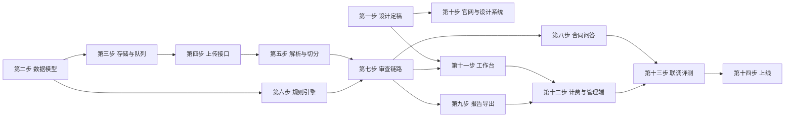

# 合同审查功能开发计划

> 版本：v1.1（单人 + Codex 修订）  
> 日期：2026-10-20  
> 依据：`docs/合同审查开发方案.md`、`docs/功能扩展与垂直化建议.md`  
> 开发方式：1 人全栈，使用 Codex 辅助编码与测试，无并行人力。  
> 工作量：约 41 个有效开发日 + 5 天缓冲；全职（每周 5 天）约 9 周，业余（每周 15–20 小时）约 4–5 个月。  
> 排期原则：严格串行推进，先打通“上传 → 解析 → 审查 → 展示”主链路，再做报告、计费和管理端，最后做视觉打磨与评测。  
> 压缩版：6 周全职，只做核心闭环（上传、解析、审查、风险清单、DOCX 报告），砍掉合同问答与管理端规则编辑。

---

## 1. 总体安排

### 1.1 阶段划分

| 阶段 | 周期 | 目标 | 主要交付物 |
| --- | --- | --- | --- |
| 阶段 0 | 第 1 周 | 设计定稿、数据模型 | 设计令牌、Prisma 模型、页面样例 |
| 阶段 1 | 第 2 周 | 存储、上传、解析 | 本地上传、PDF/DOCX 解析、条款落库 |
| 阶段 2 | 第 3 周 | 规则引擎 | 10 条内置规则、规则集 |
| 阶段 3 | 第 4–5 周 | 审查主链路 | 任务状态、模型审查、风险清单 |
| 阶段 4 | 第 6 周 | 前端设计系统与官网 | 深色官网、登录、工作台骨架 |
| 阶段 5 | 第 7 周 | 审查详情与追问 | 三栏审查页、条款联动、合同问答 |
| 阶段 6 | 第 8 周 | 报告、计费、管理端 | DOCX 报告、额度账本、规则后台 |
| 阶段 7 | 第 9 周 | 联调、评测、上线 | 回归通过、部署、验收 |

### 1.2 里程碑

| 里程碑 | 时间 | 验收条件 |
| --- | --- | --- |
| M0 设计与地基 | 第 1 周末 | 设计令牌与页面样例定稿；`prisma migrate` 成功 |
| M1 上传解析 | 第 2 周末 | 上传 10 份样本合同，条款切分正确率 ≥ 90% |
| M2 规则引擎 | 第 3 周末 | 10 条内置规则稳定命中，可解释 |
| M3 审查闭环 | 第 5 周末 | 规则 + 模型产出风险清单，可定位原文 |
| M4 前端可用 | 第 7 周末 | 工作台、上传、审查页、问答完整可走通 |
| M5 商业闭环 | 第 8 周末 | 报告可下载，额度可扣减，管理端可配规则 |
| M6 上线 | 第 9 周末 | 验收清单全部通过，生产环境可用 |

### 1.3 完成定义（DoD）

每个步骤完成需同时满足：

- 代码通过 `npm run build`（前端与后端）；
- 关键逻辑有单元测试或接口测试；
- 接口有 DTO 校验与权限校验；
- 列表/详情/错误状态在前端有对应 UI；
- 相关文档更新到 `docs/`；
- 不引入未使用的依赖；
- Codex 生成的改动必须人工审阅 diff，重点看权限、事务与错误分支；
- 单步改动文件数控制在 10 个以内，超出则拆分；
- 每步结束提交一次 commit，并在本文档状态表更新。

### 1.4 单人节奏建议

- 每天只推进一个可验收的小目标，避免同时开多个半成品；
- 建议节奏：白天让 Codex 实现，当天自测并修 bug，收尾写 5 行交接摘要；
- 每周留半天做回归，防止后一步改坏前一步；
- 如果一周内没有可演示的东西，说明步骤切得太大，立即拆小。

### 1.5 压缩版（6 周）范围

保留：

- 官网简版、登录、工作台、上传、解析；
- 规则 + 模型审查、风险清单、条款定位；
- DOCX 报告、基础额度扣减；
- 管理端只保留规则查看与任务列表。

砍掉：

- 合同内问答（第 8 步）；
- PDF 打印、报告样式细节；
- 管理端规则编辑与版本管理；
- 官网合作伙伴、新闻、动效细节；
- 独立的审查任务监控页。

压缩版先保证“能上传、能审、能看、能导出”，其余功能在核心闭环稳定后再补。

---

## 2. 分步任务

### 第一步：设计定稿与工程准备（2 人日）

**目标**：把视觉与交互先定下来，避免后期返工。

**任务**

- 建立设计令牌：颜色、字体、间距、圆角、阴影、网格背景；
- 产出设计系统预览页 `/design`，用于走查色彩、排版、按钮、状态标签与深色/纸面组合；
- 4 个关键页面的高保真稿直接进入第十、十一步实现，不再重复画静态稿；
- 确定深色外壳 + 浅色纸面的阅读区方案；
- 在 `frontend/src/app/globals.css` 写入 Tailwind 4 `@theme`；
- 在 `providers.tsx` 配置 Ant Design 深色主题；
- 新增 `components/common` 基础组件：`TechButton`、`StatusTag`、`SectionTitle`、`EmptyState`。

**涉及文件**

- `frontend/src/app/globals.css`
- `frontend/src/app/providers.tsx`
- `frontend/src/components/common/*`
- `docs/合同审查开发方案.md`（视觉章节）

**验收**

- 1440px 与 768px 两个宽度下样例页面通过自检；
- 主色、字号、间距全部来自令牌，无散落硬编码色值。

---

### 第二步：数据模型与迁移（2 人日）

**目标**：一次性把合同、条款、任务、规则、报告、用量的数据结构定稳。

**任务**

- 在 `backend/prisma/schema.prisma` 新增枚举与模型；
- 扩展 `MemberPlan`：审查额度、最大页数、最大文件大小；
- 生成迁移并更新 seed 数据（默认规则集、示例套餐）；
- 编写 `prisma/seed-review-rules.js` 初始化首批 10 条规则；
- 在 `User` 上补关系字段。

**涉及文件**

- `backend/prisma/schema.prisma`
- `backend/prisma/migrations/*`
- `backend/prisma/seed.js`
- `backend/prisma/seed-review-rules.js`

**验收**

- `npx prisma migrate dev` 无报错；
- 新旧表外键关系正确，删除用户时合同按策略处理；
- 种子数据可重复执行（幂等）。

---

### 第三步：存储与队列基础设施（2 人日）

**目标**：为异步审查准备可靠的存储与任务通道。

**任务**

- 新增 `storage` 模块，定义 `StorageService` 接口（put / get / signedUrl / delete）；
- 实现 `LocalStorageDriver` 与 `S3StorageDriver`；
- 新增 `queue` 模块，接入 BullMQ（`@nestjs/bullmq` + `bullmq`）；
- 定义任务类型：`parse-document`、`review-document`、`generate-report`、`cleanup`;
- 在 `QueueModule` 内启动进程内 Worker（`WorkerHost`），不单独部署；
- 在 `docker-compose.yml` 为 backend 挂载 `uploads` 卷（MinIO 与独立 worker 留到后续）；
- 增加环境变量与配置校验。

**涉及文件**

- `backend/src/storage/*`
- `backend/src/queue/*`
- `backend/src/config/configuration.ts`
- `backend/package.json`
- `docker-compose.yml`

**验收**

- 本地上传文件可通过签名 URL 访问；
- 入队任务可被 worker 消费，失败可重试；
- 服务重启后任务不丢失。

---

### 第四步：上传接口（2 人日）

**目标**：用户可以上传合同并创建项目。

**任务**

- 新增 `contracts` 模块：Controller / Service / DTO；
- `POST /api/contracts` 支持 multipart；
- 文件校验：扩展名、MIME、文件头、大小、页数；
- `sha256` 去重检测；
- 创建 `ContractProject` 与 `ContractDocument`；
- 入队解析任务；
- 前端 `UploadDropzone` 组件与页面骨架（先不做最终视觉）。

**涉及文件**

- `backend/src/contracts/*`
- `frontend/src/app/workspace/contracts/new/page.tsx`
- `frontend/src/components/workspace/upload-dropzone.tsx`
- `frontend/src/lib/api/contracts.ts`

**验收**

- 上传合法文件返回项目 ID；
- 非法类型/超大文件返回明确错误；
- 重复文件提示并复用解析结果。

---

### 第五步：解析与条款切分（4 人日）

**目标**：把合同变成可定位的条款数组。

**任务**

- 实现 `PdfParserService`（`pdfjs-dist`，按页提取文本项）；
- 实现 `DocxParserService`（`mammoth`，保留段落顺序）；
- 实现 `ClauseSplitterService`：编号正则、段落回退、标题识别；
- 条款类型识别：付款、违约、终止、保密、知识产权、争议解决、其他；
- 计算页码区间与字符区间；
- 扫描件检测与友好报错；
- 解析结果写入 `ContractClause`，更新 `parseStatus`；
- 编写 10 份样本的解析回归测试。

**涉及文件**

- `backend/src/parsing/*`
- `backend/src/queue/processors/parse.processor.ts`
- `backend/test/parsing/*.spec.ts`

**验收**

- 样本合同条款顺序正确；
- 每条条款页码与原文可回溯；
- 解析失败有明确原因，可重试。
---

### 第六步：规则引擎（3 人日）

**目标**：可解释、可配置的确定性审查能力。

**任务**

- 定义规则执行接口 `ReviewRuleHandler`；
- 实现五种规则类型：`PRESENCE`、`REGEX`、`KEYWORD`、`THRESHOLD`、`LLM`；
- 规则配置 JSON Schema 校验；
- 规则命中结果统一映射为 `ReviewFindingDraft`；
- 规则集加载与版本记录；
- 为每条内置规则编写命中 / 未命中用例；
- 管理端规则 CRUD 接口（先接口，后台页面后置）。

**涉及文件**

- `backend/src/rules/*`
- `backend/src/reviews/rule-runner.service.ts`
- `backend/test/rules/*.spec.ts`

**验收**

- 10 条内置规则在样本合同上结果稳定；
- 规则命中带条款定位与原文片段；
- 关闭规则后不再产出对应结论。

---

### 第七步：审查任务与模型链路（5 人日）

**目标**：从任务创建到风险清单的完整异步链路。

**任务**

- `reviews` 模块：创建任务、查询状态、重试、取消；
- 任务状态机与进度上报（Redis + 数据库）；
- 额度检查：会员、月度剩余页数、并发限制；
- `ReviewProcessor`：规则阶段 → 模型阶段 → 汇总阶段；
- 条款分块、并发控制、map-reduce 汇总、去重排序；
- JSON 输出校验（Zod），失败重试与降级；
- 提示词模板：系统层、规则层、文档层、输出层；
- `UsageLedger` 记账（页数、tokens、成本）；
- 前端轮询 hook `useReviewTask`；
- 审查结果查询接口与筛选。

**涉及文件**

- `backend/src/reviews/*`
- `backend/src/queue/processors/review.processor.ts`
- `backend/src/ai/structured-output.service.ts`
- `backend/src/usage/*`
- `frontend/src/lib/hooks/use-review.ts`
- `frontend/src/lib/api/reviews.ts`

**验收**

- 30 页合同 3 分钟内完成；
- 模型输出异常时任务不崩溃，保留规则结果；
- 任务失败可重试，额度不重复扣减；
- 风险清单按等级、类别、条款排序正确。

---

### 第八步：合同内问答（2 人日）

**目标**：围绕当前合同追问，答案引用条款。

**任务**

- 新增 `POST /api/contracts/:id/chat` SSE 接口；
- 条款检索：关键词 + 条款序号 + 类型过滤，取 Top 8；
- 组装上下文：合同概要 + 条款 + 历史对话（最多 5 轮）；
- 复用 `AiClientService.streamChat`；
- 前端 `ContractChatPanel`，支持引用跳转与中断；
- 无答案时明确说明，不编造。

**涉及文件**

- `backend/src/contracts/contract-chat.controller.ts`
- `backend/src/contracts/contract-chat.service.ts`
- `frontend/src/components/review/contract-chat-panel.tsx`
- `frontend/src/lib/api/contract-chat.ts`

**验收**

- 首字节延迟 < 2 秒；
- 回答中的 `[第X条]` 可点击定位；
- 断线后重连不产生重复消息。

---

### 第九步：报告导出（2 人日）

**目标**：把审查结果变成可交付文件。

**任务**

- `reports` 模块：生成任务、状态查询、签名下载；
- 使用 `docx` 生成报告，封装封面、统计、明细、免责声明；
- 报告模板与合同信息、风险项、处理状态绑定；
- 报告快照摘要写入 `ReviewReport`；
- 前端报告预览页与下载 / 打印按钮；
- 文件名与存储键规范化。

**涉及文件**

- `backend/src/reports/*`
- `backend/src/queue/processors/report.processor.ts`
- `frontend/src/app/workspace/contracts/[id]/report/page.tsx`
- `frontend/src/components/report/*`

**验收**

- 报告包含全部必填章节；
- 中文不乱码，表格不溢出；
- 下载链接 5 分钟过期且校验归属。
---

### 第十步：前端设计系统与官网（4 人日）

**目标**：先把“像 powerlaw.ai”的视觉语言做成可复用组件，再铺页面。

**任务**

- 完成 `globals.css` 设计令牌与网格背景；
- 完成 `MarketingShell`：导航、页脚、区块容器；
- 完成官网首页：首屏、产品展示、能力区块、核心优势、场景、价格、页脚；
- 产品截图区使用“浅色界面 + 青绿描边柔光”的 `ProductFrame`；
- 登录 / 注册页改为深色视觉；
- 处理 768px 与 1280px 断点；
- 接入滚动淡入动画（`IntersectionObserver`）。

**涉及文件**

- `frontend/src/app/page.tsx`
- `frontend/src/app/(auth)/login/page.tsx`
- `frontend/src/app/(auth)/register/page.tsx`
- `frontend/src/components/marketing/*`
- `frontend/src/app/globals.css`

**验收**

- 首屏与参考站在气质上一致：近黑底、青绿主色、细网格、大标题；
- 所有按钮、卡片、标签来自统一组件；
- Lighthouse 性能 ≥ 80，移动端无横向滚动。

---

### 第十一步：工作台与审查详情页（5 人日）

**目标**：交付日常使用的核心界面。

**任务**

- `WorkspaceShell`：左侧深色导航、顶部额度条、用户菜单；
- 工作台首页：统计卡、合同列表、空状态、上传入口；
- 上传页：拖拽、类型/立场/规则集选择、校验提示；
- 审查详情页三栏：条款导航、浅色合同纸面、风险面板；
- 风险项与条款联动高亮、滚动定位；
- 风险筛选、处理状态更新；
- 审查进度组件（阶段 + 百分比）；
- 合同问答面板；
- 移动端风险抽屉与响应式适配。

**涉及文件**

- `frontend/src/app/workspace/*`
- `frontend/src/components/workspace/*`
- `frontend/src/components/review/*`
- `frontend/src/lib/hooks/use-contracts.ts`
- `frontend/src/lib/hooks/use-review.ts`
- `frontend/src/types/contract.ts`

**验收**

- 上传 → 审查 → 查看风险 → 追问全流程可走通；
- 三栏页面在 1280px 下不挤压，纸面可读；
- 空状态、加载态、错误态齐全。

---

### 第十二步：计费与管理端（3 人日）

**目标**：形成可收费、可运营的闭环。

**任务**

- 套餐增加审查额度字段并在定价页展示；
- `GET /api/usage/summary` 与额度进度组件；
- 管理端规则管理页（列表、新增、编辑、启停、版本）；
- 审查任务监控页（状态、耗时、失败原因、重试）；
- 用量统计页（按用户/月份聚合）；
- 管理端菜单与路由接入。

**涉及文件**

- `backend/src/admin/rules/*`
- `backend/src/admin/reviews/*`
- `backend/src/admin/usage/*`
- `frontend/src/app/admin/rules/page.tsx`
- `frontend/src/app/admin/reviews/page.tsx`
- `frontend/src/app/admin/usage/page.tsx`
- `frontend/src/components/admin/admin-shell.tsx`

**验收**

- 管理员可新增规则并立即生效；
- 失败任务可在后台重试；
- 用量数据与账本一致。

---

### 第十三步：联调、评测与修复（3 人日）

**目标**：把功能从“能跑”推到“可用”。

**任务**

- 端到端用例：上传 → 解析 → 审查 → 报告 → 下载；
- 20 份样本合同回归，记录条款切分与风险命中；
- 权限测试：跨用户访问、未登录、额度不足、管理员越权；
- 性能测试：并发 5 个审查任务；
- 前端视觉走查与移动端真机检查；
- 修复阻塞性问题，更新文档。

**涉及文件**

- `backend/test/e2e/*`
- `docs/合同审查开发方案.md`（补充实现差异）
- `docs/合同审查开发计划.md`（更新状态）

**验收**

- 主流程无阻断缺陷；
- 高风险误报率可接受（样本集上人工评估）；
- 上线检查清单通过。

---

### 第十四步：上线（2 人日）

**目标**：安全上线并具备回滚能力。

**任务**

- 生产环境变量与密钥检查；
- 数据库迁移与备份；
- uploads 卷权限与磁盘空间检查；
- Nginx 上传大小、超时、SSE 配置；
- worker 进程守护与日志；
- 灰度发布与回滚脚本；
- 上线后监控：任务成功率、平均耗时、模型成本。

**验收**

- 生产环境完成一次真实合同全流程；
- 监控指标可见；
- 回滚步骤演练通过。

---

## 3. 周排期

| 周次 | 主要工作 | 周末交付 |
| --- | --- | --- |
| 第 1 周 | 设计定稿、数据模型（第 1–2 步） | M0：令牌、样例页、迁移通过 |
| 第 2 周 | 存储、上传、解析（第 3–5 步） | M1：样本合同条款落库 |
| 第 3 周 | 规则引擎、审查任务骨架（第 6 步、第 7 步前半） | M2：规则可跑 |
| 第 4 周 | 模型链路、结果接口（第 7 步后半） | 风险清单可出 |
| 第 5 周 | 审查链路收尾、前端设计系统（第 7、10 步） | M3：审查闭环 |
| 第 6 周 | 官网、工作台（第 10–11 步前半） | 页面可演示 |
| 第 7 周 | 审查详情、合同问答（第 11 步后半、第 8 步） | M4：主流程可用 |
| 第 8 周 | 报告、计费、管理端（第 9、12 步） | M5：商业闭环 |
| 第 9 周 | 联调、评测、上线（第 13–14 步） | M6：上线 |

> 业余推进（每周 15–20 小时）建议按 16–20 周排；只想尽快看到成果时走压缩版，先交付核心闭环，再补管理与营销页面。

---

## 4. 依赖关系


---

## 5. Codex 协作流程

单人开发最大的风险不是写不完，而是“改乱了”和“上下文丢失”。把每个步骤当作一次独立交付。

### 5.1 会话启动模板

```text
目标：完成《合同审查开发计划》第 X 步：<步骤名>。
上下文：先读 docs/合同审查开发方案.md 的 <章节> 和 docs/合同审查开发计划.md 的第 X 步。
范围：只允许修改 <文件列表>；不要改 <禁止区域>。
要求：
1. 先给出 5 行以内的执行计划，等我确认；
2. 小步修改，保持现有代码风格；
3. 补必要测试；
4. 最后运行 <构建/测试命令> 并报告结果。
验收：<可观察的结果>。
```

### 5.2 每步固定动作

1. 开新会话，贴启动模板；
2. Codex 先给计划，确认后再改；
3. 小步实现，随时 build；
4. 人工 review diff；
5. 跑验收命令；
6. commit 并更新本文档状态表；
7. 写 5 行交接摘要，作为下一步的上下文。

### 5.3 人工 review 清单

- 权限：所有查询是否带 `userId` 或角色校验；
- 事务：扣额度与写结果是否在同一事务或可补偿；
- 错误分支：模型超时、解析失败、文件非法是否有兜底；
- 日志：是否打印合同全文、API Key、token；
- 依赖：是否引入不必要的新包；
- 测试：是否覆盖失败路径，而不只覆盖成功路径。

### 5.4 上下文管理

- 在仓库根目录维护 `AGENTS.md`，写清技术栈、目录约定与禁止事项；
- 新会话先读两份文档，不要依赖上一轮记忆；
- 每步结束把“改了什么、验证命令、遗留问题”写进交接记录或 commit 信息；
- 只让 Codex 读取相关文件片段，避免把整个仓库塞进上下文。

### 5.5 常用命令

```bash
# 后端
cd backend && npm run build && npm run test
# 前端
cd frontend && npm run build && npm run lint
# 数据库
cd backend && npx prisma migrate dev
```

---

## 6. 测试计划

### 6.1 单元测试

| 对象 | 用例 |
| --- | --- |
| 解析器 | 单页/多页 PDF、带表格 DOCX、无编号合同、超长条款 |
| 切分器 | 编号识别、标题识别、页码偏移、空段落 |
| 规则引擎 | 各规则类型命中/未命中、阈值边界、配置非法 |
| 额度服务 | 会员有效/过期、额度不足、并发限制、失败冲正 |
| 模型输出 | 合法 JSON、缺字段、非法 JSON、超时 |
| 报告 | 章节完整、中文编码、空风险列表 |

### 6.2 接口测试

- 上传：合法/非法类型、超大文件、重复文件、未登录、非会员；
- 审查：无权限合同、任务重复创建、取消、重试；
- 查询：分页、筛选、跨用户访问返回 404；
- 报告：生成中、生成失败、下载过期；
- 管理端：非管理员访问返回 403。

### 6.3 端到端测试

```text
注册/登录 -> 购买会员 -> 上传合同 -> 等待解析 -> 创建审查
-> 查看风险 -> 追问 -> 导出报告 -> 下载 -> 删除合同
```

### 6.4 质量指标

- 条款切分准确率 ≥ 90%（20 份样本）；
- 高风险漏报可接受，误报率记录并迭代；
- 30 页合同审查耗时 ≤ 3 分钟；
- 任务成功率 ≥ 98%（不含模型服务故障）；
- 主流程接口 P95 < 500ms（不含异步任务）。

---

## 7. 上线检查清单

- [ ] `prisma migrate deploy` 已在预发验证；
- [ ] 生产数据库已备份；
- [ ] uploads 卷可写，且不在 Web 根目录；
- [ ] 上传大小限制与 Nginx 配置一致；
- [ ] SSE 关闭缓冲，超时 ≥ 300 秒；
- [ ] worker 进程随容器重启；
- [ ] 模型 Key 加密存储且可轮换；
- [ ] 日志脱敏，不记录合同全文与 Key；
- [ ] 报告下载链接有效期 5 分钟；
- [ ] 免责声明与隐私政策已更新；
- [ ] 监控与告警：任务失败率、队列积压、模型错误率；
- [ ] 回滚脚本与旧版本镜像可用。

---

## 8. 进度风险与应对

| 风险 | 触发信号 | 应对 |
| --- | --- | --- |
| 解析质量不达标 | 样本切分准确率 < 80% | 收窄合同类型，先支持销售/NDA；增加人工校对入口 |
| 模型不稳定 | JSON 解析失败率 > 10% | 降低温度、增加重试、规则兜底、换模型 |
| 前端视觉返工 | 样例页评审未通过 | 先冻结令牌与组件，再铺页面 |
| 排期延误 | 连续两周未达里程碑 | 砍掉报告 PDF、合同问答等非核心项，保 M2 |
| 成本超预算 | 单份合同 token 成本过高 | 限制页数、分块缓存、规则前置过滤 |

---

## 9. 前端视觉验收清单

- [ ] 首屏为近黑背景 + 细网格 + 青绿光晕；
- [ ] 主色 `#00CCAB` 仅用于强调，不大面积铺满；
- [ ] 大标题为白色粗体，英文标签为宽字距小字；
- [ ] 主按钮为青绿实心 + 黑字，次按钮为白描边；
- [ ] 产品截图使用浅色界面 + 青绿描边柔光；
- [ ] 优势卡片为 2×2 深灰卡片，顶部青绿线；
- [ ] 工作台为深色外壳，合同纸面为浅色；
- [ ] 风险等级同时使用颜色与文字；
- [ ] 1280 / 768 / 375 三个宽度无布局错乱；
- [ ] 键盘可完成上传与查看风险；
- [ ] `prefers-reduced-motion` 下关闭位移动画。

---

## 10. 状态跟踪

建议在仓库根目录维护一个简单的进度表（也可用 GitHub Issues）。每完成一步更新状态，并在 commit 信息中带上步骤编号：

| 步骤 | 状态 | 负责人 | 开始 | 完成 |
| --- | --- | --- | --- | --- |
| 第一步 设计定稿 | 已完成 | 本人 | 2026-10-20 | 2026-10-20 |
| 第二步 数据模型 | 已完成 | 本人 | 2026-10-21 | 2026-10-21 |
| 第三步 存储与队列 | 已完成 | 本人 | 2026-10-21 | 2026-10-21 |
| 第四步 上传接口 | 已完成 | 本人 | 2026-10-21 | 2026-10-21 |
| 第五步 解析与切分 | 未开始 |  |  |  |
| 第六步 规则引擎 | 未开始 |  |  |  |
| 第七步 审查链路 | 未开始 |  |  |  |
| 第八步 合同问答 | 未开始 |  |  |  |
| 第九步 报告导出 | 未开始 |  |  |  |
| 第十步 官网与设计系统 | 未开始 |  |  |  |
| 第十一步 工作台与审查页 | 未开始 |  |  |  |
| 第十二步 计费与管理端 | 未开始 |  |  |  |
| 第十三步 联调评测 | 未开始 |  |  |  |
| 第十四步 上线 | 未开始 |  |  |  |
