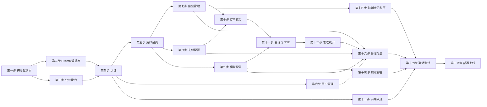

# 大模型对话系统分步开发计划

> 版本：v1.0  
> 日期：2026-09-12  
> 依据：`docs/开发方案.md`、`docs/数据库与接口文档.md`  
> 技术栈：Next.js + NestJS + TypeScript + Prisma + MySQL + Redis

本计划严格按两份文档执行。每步包含目标、依据、开发任务、完成标志和验收标准。步骤之间存在依赖关系，建议按顺序完成；前端与后端可拆分为两个开发者或两个任务队列并行推进，但联调前必须完成对应接口。

---

## 总体阶段

| 阶段 | 步骤 | 主题 | 主要产出 |
| --- | --- | --- | --- |
| 基础建设 | 1-3 | 项目、数据库、公共能力 | 可运行骨架、Prisma Schema、统一响应 |
| 核心业务 | 4-10 | 认证、会员、支付、模型、对话 | 后端全部核心接口 |
| 前端实现 | 11-15 | 页面、权限、流式聊天、后台 | 用户端与管理端页面 |
| 交付 | 16 | 联调、测试、部署 | 可上线版本 |

---

## 第一步：初始化项目与环境

### 目标

建立前后端两个独立项目，配置基础运行环境、环境变量和统一代码目录。

### 依据


- `docs/开发方案.md` 第 2 章技术选型、第 7.1 前端结构、第 5.1 后端结构。

### 开发任务

- 后端：创建 NestJS + TypeScript 项目，配置 ESLint、Prettier、Pino 日志。
- 后端：建立 `common`、`config`、`prisma` 等基础目录。
- 后端：接入 Redis，配置 `ConfigModule` 读取环境变量。
- 前端：创建 Next.js + TypeScript 项目，启用 App Router。
- 前端：接入 Tailwind CSS、Ant Design、Zustand、TanStack Query。
- 前端：建立 `src/lib`、`src/components`、`src/types` 等基础目录。
- 仓库：准备 `.env.example`，分别管理 MySQL、Redis、JWT、支付、模型配置。

### 环境变量清单

后端至少包含：

```text
DATABASE_URL
REDIS_URL
JWT_ACCESS_SECRET
JWT_ACCESS_EXPIRES_IN
JWT_REFRESH_SECRET
JWT_REFRESH_EXPIRES_IN
PAYMENT_BASE_URL
```

前端至少包含：

```text
NEXT_PUBLIC_API_BASE_URL
```

### 完成标志

- 后端可启动并响应健康检查。
- 前端可启动并访问首页。
- 两个项目均可读取环境变量。

### 验收标准

- 本地运行 `npm run dev` 不报错。
- 前后端目录结构与文档基本一致。

---

## 第二步：设计数据库与 Prisma Schema

### 目标

按数据库文档创建 Prisma Schema、枚举、关系和索引，并生成迁移。

### 依据

- `docs/数据库与接口文档.md` 第 1 章 ER 图、第 2 章表结构、第 3 章 Prisma 映射。

### 开发任务

- 创建 `User`、`MemberPlan`、`UserMembership`、`Order`、`PaymentConfig`、`ModelConfig`、`Conversation`、`Message`。
- 可选创建 `LoginLog`、`SystemConfig`。
- 定义枚举：`UserRole`、`OrderStatus`、`MessageRole`、`PlanDurationType`、`ModelProvider`。
- 按文档设置唯一索引、联合索引、外键和级联策略。
- 创建 Prisma Client 全局 Service。
- 执行第一次迁移。
- 编写种子脚本：创建 1 个管理员账号、若干测试用户、若干套餐和模型配置。

### 必须遵循的约束

- `users.username` 唯一。
- `user_memberships.user_id` 唯一。
- `orders.order_no` 唯一。
- `messages.conversation_id` 关联 `conversations.id` 并级联删除。
- 套餐和模型使用 `enabled` 控制上下架。

### 完成标志

- `prisma migrate dev` 成功生成迁移。
- 种子脚本可重复执行且不重复插入管理员。

### 验收标准

- 数据库表、字段、索引与文档一致。
- Prisma Studio 可查看种子数据。

---

## 第三步：搭建后端公共能力

### 目标

实现统一响应、异常处理、日志、Redis 和通用校验，供后续模块复用。

### 依据

- `docs/数据库与接口文档.md` 第 4 章接口通用约定、第 8 章错误码。

### 开发任务

- 实现统一响应结构：`{ code, message, data }`。
- 实现全局异常过滤器，映射文档中的错误码。
- 实现 `BusinessException`。
- 实现日志拦截器，记录请求方法、路径、耗时、用户 ID。
- 封装 Redis 服务：`get`、`set`、`del`、`setnx`、`expire`。
- 实现分页工具和分页响应结构。
- 配置 CORS。

### 必须遵循的约定

- 成功响应 `code = 0`。
- 参数错误 `10001`，未登录 `10002`，无权限 `10003`。
- 分页响应包含 `list`、`total`、`page`、`pageSize`。

### 完成标志

- 测试接口返回统一格式。
- 故意抛出业务异常时返回正确错误码。

### 验收标准

- 日志包含结构化信息。
- 错误码与文档一致。

---

## 第四步：实现认证模块

### 目标

完成注册、登录、退出、刷新 Token 和用户名实时查重。

### 依据

- `docs/开发方案.md` 第 5.2、5.3。
- `docs/数据库与接口文档.md` 第 5 章认证接口。

### 开发任务

- 后端实现 BCrypt 密码哈希。
- 实现 JWT Access Token 与 Refresh Token。
- 实现 NestJS `JwtAuthGuard`、`RolesGuard` 和 `CurrentUser` 装饰器。
- 实现接口：
  - `GET /api/auth/check-username`
  - `POST /api/auth/register`
  - `POST /api/auth/login`
  - `POST /api/auth/refresh`
  - `POST /api/auth/logout`
- 注册时校验用户名唯一、两次密码一致。
- 退出时将 Refresh Token 写入 Redis 黑名单或删除会话。
- 可选：记录 `login_logs`。

### 必须遵循的规则

- 用户名 4-32 位，字母数字或下划线。
- 密码 8-64 位，至少包含字母和数字。
- 数据库不保存明文密码。
- 用户名查重接口返回 `available`，重复时返回建议后缀。

### 完成标志

- 使用 Postman 或 HTTP 客户端可完成注册、登录、刷新、退出。
- 未携带 Token 访问受保护接口返回 `10002`。

### 验收标准

- 用户名重复注册返回 `10005`。
- 密码不一致返回 `10001`。
- 登录成功返回 Access Token、Refresh Token 和用户信息。

---

## 第五步：实现用户与会员状态接口

### 目标

提供当前用户信息、会员状态和公开套餐列表。

### 依据

- `docs/数据库与接口文档.md` 第 6 章用户与会员接口。

### 开发任务

- 实现 `GET /api/users/me`。
- 实现 `PUT /api/users/me`。
- 实现 `GET /api/memberships/me`。
- 实现 `GET /api/member-plans`。
- 实现会员身份判断：`管理员或未过期`。
- 创建用户时初始化 `user_memberships` 记录，到期时间可为当前时间之前或空。

### 必须遵循的规则

- `GET /api/member-plans` 只返回 `enabled = 1` 的套餐。
- 套餐按 `sort` 升序。
- 会员状态返回 `isMember` 和 `expireAt`。

### 完成标志

- 登录用户可获取自己的信息和会员状态。
- 未登录用户可获取上架套餐。

### 验收标准

- 普通用户 `isMember = false`。
- 管理员 `isMember = true`。
- 修改套餐 `enabled` 后，公开接口结果同步变化。

---

## 第六步：实现管理端用户管理

### 目标

让管理员可以查询、修改用户角色和状态。

### 依据

- `docs/数据库与接口文档.md` 第 9.1 用户管理。

### 开发任务

- 实现管理员接口：
  - `GET /api/admin/users`
  - `GET /api/admin/users/{id}`
  - `PUT /api/admin/users/{id}`
  - `DELETE /api/admin/users/{id}`
- 接入 `RolesGuard`，仅 `ADMIN` 可访问。
- 支持按 `keyword`、`role`、`status` 过滤。
- 禁止管理员删除自己或降级自己，避免系统失去管理入口。

### 完成标志

- 管理员可管理用户。
- 普通用户访问管理接口返回 `10003`。

### 验收标准

- 角色和状态修改立即生效。
- 禁用用户无法登录或访问受保护接口。

---

## 第七步：实现套餐管理

### 目标

实现套餐 CRUD，使用户端套餐动态变化。

### 依据

- `docs/开发方案.md` 第 5.4 会员体系。
- `docs/数据库与接口文档.md` 第 9.2 套餐管理。

### 开发任务

- 实现管理端套餐 CRUD。
- 字段包含：名称、金额、有效期类型、有效天数、说明、是否上架、排序。
- 更新或删除时校验订单引用，避免破坏历史订单；订单表已保存套餐快照。
- 保证用户端 `GET /api/member-plans` 始终只读启用套餐。

### 完成标志

- 管理员可新增、修改、上下架、删除套餐。
- 用户端套餐接口返回最新配置。

### 验收标准

- 新增套餐后用户端立即可见。
- 下架套餐后用户端不再返回。
- 修改金额和说明后用户端展示更新。

---

## 第八步：实现支付配置管理

### 目标

让管理员维护支付渠道配置，配置信息先留空且可自由填写。

### 依据

- `docs/开发方案.md` 第 5.5 支付对接。
- `docs/数据库与接口文档.md` 第 2.5 支付配置表、第 9.4 支付配置管理。

### 开发任务

- 实现支付配置 CRUD。
- 字段包含：名称、渠道、商户号、应用 ID、密钥、API Key、网关地址、回调地址、返回地址、启用状态。
- 密钥字段加密存储。
- 列表和详情接口脱敏，不返回明文密钥。
- 更新时密钥为空表示保持原值。

### 完成标志

- 管理员可新增、修改、删除支付配置。
- 支付配置为空时不阻塞其他功能。

### 验收标准

- 列表接口只返回 `hasSecret: true` 之类的脱敏标识。
- 创建订单时无启用支付配置返回 `10008`。

---

## 第九步：实现模型配置管理

### 目标

让管理员维护模型 URL、Key 和模型名，作为对话页可选模型。

### 依据

- `docs/开发方案.md` 第 5.6 模型管理。
- `docs/数据库与接口文档.md` 第 2.6 模型配置表、第 9.3 模型配置管理。

### 开发任务

- 实现模型配置 CRUD。
- 字段包含：展示名称、服务类型、URL、Key、实际模型名、最大 Token、温度、是否启用、排序。
- Key 加密存储。
- 实现 `GET /api/models`，只返回启用模型，不返回 Key。

### 完成标志

- 管理员可维护多个模型。
- 对话页可获取到启用的模型列表。

### 验收标准

- 修改模型名称、排序后，模型列表立即变化。
- 接口不泄露 `apiKey`。

---

## 第十步：实现订单、支付与会员发放

### 目标

完成创建订单、支付跳转、回调验签、幂等处理和会员时长累加。

### 依据

- `docs/开发方案.md` 第 5.5 支付对接。
- `docs/数据库与接口文档.md` 第 7 章订单与支付接口、第 11 章幂等约束。

### 开发任务

- 实现 `POST /api/orders`：
  - 校验套餐上架。
  - 生成唯一 `order_no`。
  - 保存套餐名称和有效天数快照。
  - 调用启用的支付配置创建支付。
- 实现 `GET /api/orders/{orderNo}` 和 `GET /api/orders`。
- 实现 `POST /api/payment/callback`：
  - 验签。
  - 使用 `order_no` 和 Redis 锁幂等。
  - 更新订单为 `PAID`。
  - 在事务中累加会员时长。
- 实现 `GET /api/payment/return`。
- 会员累加规则：
  - 已过期：当前时间 + 套餐天数。
  - 未过期：原到期时间 + 套餐天数。
- 订单金额以服务端套餐价格为准，不信任前端金额。

### 必须遵循的规则

- 支付配置为空时返回 `10008`。
- 订单状态冲突返回 `10006`。
- 回调重复通知不重复发放。

### 完成标志

- 用户可创建订单。
- 模拟支付回调成功后，订单变更为 `PAID` 且会员时间正确增加。

### 验收标准

- 同一订单重复回调只发放一次会员。
- 订单金额与数据库套餐金额一致。
- 支付未配置时创建订单返回 `10008`。

---

## 第十一步：实现会话、消息与 SSE 对话

### 目标

完成会话管理、历史消息、5 轮上下文和大模型 SSE 流式输出。

### 依据

- `docs/开发方案.md` 第 5.7、5.8。
- `docs/数据库与接口文档.md` 第 8 章模型与对话接口、第 11.4 上下文规则、第 12 SSE 注意点。

### 开发任务

- 实现 AI 客户端适配器：
  - 默认支持 `OPENAI_COMPATIBLE`。
  - 从 `model_configs` 读取 URL、Key、模型名。
  - 支持流式和非流式请求。
- 实现接口：
  - `POST /api/conversations`
  - `GET /api/conversations`
  - `PUT /api/conversations/{id}`
  - `DELETE /api/conversations/{id}`
  - `GET /api/conversations/{id}/messages`
  - `POST /api/conversations/{id}/messages`
- 发送消息流程：
  1. 校验登录态。
  2. 校验会员或管理员。
  3. 校验会话归属。
  4. 保存用户消息。
  5. 查询最近 5 轮上下文。
  6. 调用模型。
  7. 保存助手消息。
  8. 更新会话 `last_message_at` 和标题。
  9. SSE 返回。
- 上下文最多 10 条历史消息 + 当前用户消息。
- 使用 Redis 缓存最近上下文，Key 如 `chat:context:{conversationId}`。

### SSE 事件

必须实现：

- `start`
- `delta`
- `done`
- `error`

### 完成标志

- 会员可创建会话并发送消息。
- 前端或测试客户端能读取 SSE 增量内容。
- 普通用户发送消息返回 `10007`。

### 验收标准

- 会话只允许本人访问。
- 历史消息可查看。
- 模型请求最多携带 5 轮上下文。
- 流式中断后已生成内容可保存。

---

## 第十二步：实现管理端订单与统计接口

### 目标

补齐管理端订单列表、详情和仪表盘统计。

### 依据

- `docs/数据库与接口文档.md` 第 9.5、9.6。

### 开发任务

- 实现 `GET /api/admin/orders`。
- 实现 `GET /api/admin/orders/{orderNo}`。
- 支持按订单号、用户名、状态筛选。
- 实现 `GET /api/admin/dashboard`：
  - 用户数。
  - 会员数。
  - 订单数。
  - 累计支付金额。
  - 今日支付金额。

### 完成标志

- 管理员可查看订单和统计。

### 验收标准

- 分页和筛选正确。
- 统计值与订单、用户、会员数据一致。

---

## 第十三步：实现前端认证与路由守卫

### 目标

完成注册、登录页面和路由权限控制。

### 依据

- `docs/开发方案.md` 第 7.2、7.3。
- `docs/数据库与接口文档.md` 第 5 章认证接口。

### 开发任务

- 使用 React Hook Form + Zod 实现登录、注册表单。
- 注册页：
  - 用户名输入后防抖调用查重接口。
  - 重复时显示骰子按钮。
  - 点击骰子追加随机后缀并重新查重。
  - 两次密码一致才允许提交。
- 实现 Zustand 登录态存储。
- 实现 Axios/fetch 请求封装，自动携带 Access Token。
- 实现 Token 过期后刷新或跳转登录。
- 使用 Next.js `middleware.ts` 做轻量路由守卫。
- 登录成功后根据角色和会员状态跳转。

### 完成标志

- 用户可完成注册和登录。
- 未登录访问聊天页会跳转登录页。

### 验收标准

- 用户名重复时出现骰子按钮。
- 密码不一致时无法提交。
- 登录成功显示用户信息。
- 刷新页面后登录态仍可恢复。

---

## 第十四步：实现会员购买前端

### 目标

完成套餐展示、下单、支付跳转和支付结果页。

### 依据

- `docs/开发方案.md` 第 7.2 会员页。
- `docs/数据库与接口文档.md` 第 6.4、第 7 章订单与支付接口。

### 开发任务

- 使用 TanStack Query 获取上架套餐。
- 展示套餐金额、有效期、说明文字。
- 点击充值调用 `POST /api/orders`。
- 根据返回 `payUrl` 跳转或展示支付二维码。
- 支付返回页查询订单状态。
- 支付成功后刷新 `GET /api/memberships/me`。
- 普通用户对话页显示会员引导。

### 完成标志

- 用户可选择套餐并跳转支付。
- 支付完成后会员状态更新。

### 验收标准

- 套餐由后端动态渲染。
- 支付未配置时给出友好提示。
- 支付成功后页面显示会员到期时间。

---

## 第十五步：实现聊天前端与流式渲染

### 目标

完成对话页、历史记录、模型切换和 SSE 流式渲染。

### 依据

- `docs/开发方案.md` 第 7.2 对话页、第 7.4 前端交互。
- `docs/数据库与接口文档.md` 第 8 章模型与对话接口、第 12 SSE。

### 开发任务

- 左侧：
  - 会话列表。
  - 新建会话。
  - 重命名。
  - 删除。
- 右侧：
  - 消息列表。
  - 用户和助手消息样式。
  - 支持 Markdown 渲染。
- 底部：
  - 输入框。
  - 模型选择器，数据来自 `GET /api/models`。
- 使用 `fetch` 读取 SSE `ReadableStream`。
- 实现 `start`、`delta`、`done`、`error` 事件处理。
- 流式输出时增量追加文本。
- 发送中禁止重复提交。
- 长消息列表使用虚拟滚动。
- 普通用户显示会员引导并禁用发送。

### 完成标志

- 会员可正常对话，助手回复流式显示。
- 历史会话可切换、重命名和删除。

### 验收标准

- 模型选择器显示启用模型。
- 用户切换模型后新会话绑定所选模型。
- 
- 普通用户不能发送消息。
- 流式输出中断或报错时前端状态正确。

---

## 第十六步：实现管理后台前端

### 目标

完成管理员后台全部页面。

### 依据

- `docs/开发方案.md` 第 7.2 管理后台。
- `docs/数据库与接口文档.md` 第 9 章管理端接口。

### 开发任务


- 管理端布局和菜单。
- 仪表盘页。
- 用户管理页。
- 套餐管理页。
- 模型管理页。
- 支付配置管理页。
- 订单管理页。
- 表单使用 React Hook Form + Zod。
- 列表使用 TanStack Query 管理分页和筛选。
- 密钥字段脱敏显示。
- 角色为 `ADMIN` 才可进入后台。

### 完成标志

- 管理员可完成所有配置和管理操作。

### 验收标准

- 用户管理、套餐管理、模型管理、支付管理、订单管理均可正常使用。
- 密钥明文不出现在列表接口响应和前端页面。
- 非管理员无法进入后台。

---

## 第十七步：联调、测试与修复

### 目标

按完整用户旅程验证所有功能，并修复跨端问题。

### 依据

- `docs/开发方案.md` 第 10 验收标准。
- `docs/数据库与接口文档.md` 第 10 权限矩阵。

### 测试场景

- 注册查重、骰子按钮、密码不一致。
- 登录、刷新 Token、退出。
- 普通用户进入聊天页被拦截。
- 会员购买套餐、支付回调、会员时间累加。
- 会员发送消息、切换模型、查看历史。
- 5 轮上下文截断。
- 管理员配置套餐、模型、支付。
- 非管理员访问后台被拒绝。
- 支付回调重复通知幂等。
- 模型 Key 和支付密钥不泄露。

### 完成标志

- 所有验收标准通过。
- 关键错误已修复并记录。

---

## 第十八步：部署与上线

### 目标

部署到生产或预发布环境。

### 依据

- `docs/开发方案.md` 第 2.4 部署形态、第 11 风险注意。

### 开发任务

- 前端构建并部署到 Vercel 或 Nginx + Node。
- 后端使用 Docker + Node.js 部署。
- 配置 MySQL、Redis 持久化。
- 配置 HTTPS。
- 配置支付回调公网地址。
- 配置日志收集与文件挂载。
- 设置 Nginx SSE 缓冲关闭。
- 执行 Prisma 生产迁移。

### 完成标志

- 生产环境可访问。
- 支付回调地址公网可达。
- 对话 SSE 不出现缓冲问题。

---

## 步骤依赖图



---

## 执行顺序建议

- 后端优先完成第一至第十一步，前端可同时从第十三步开始。
- 管理后台前端必须在第六、七、八、九、十二步接口完成后联调。
- 支付模块是高风险项，建议提前确认支付平台文档后实现。
- 每完成一步都按“验收标准”检查，再进入下一步。