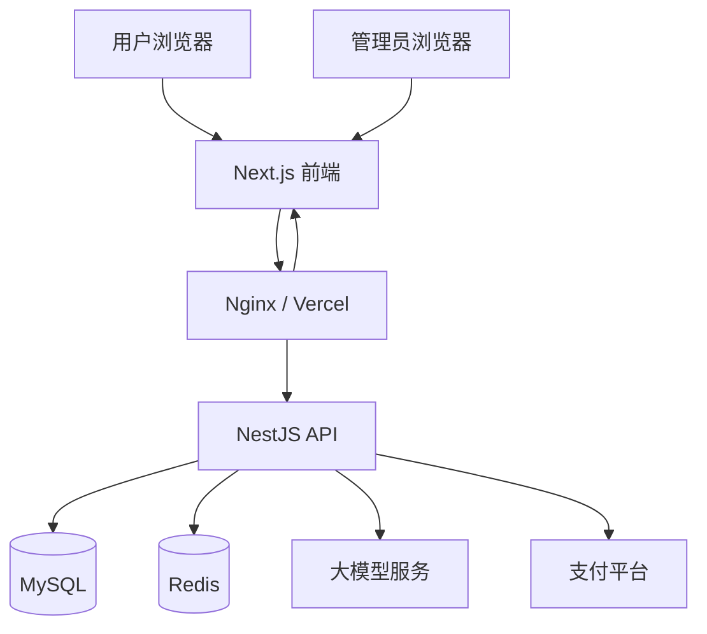
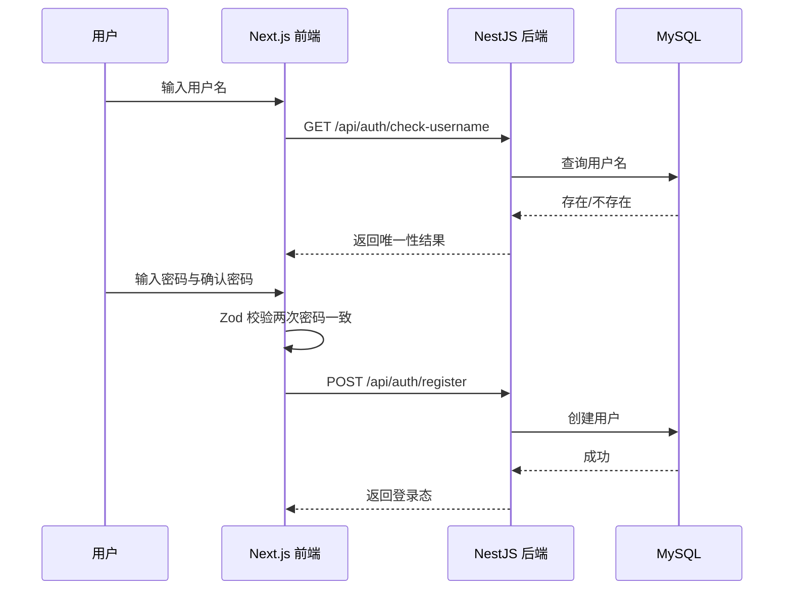
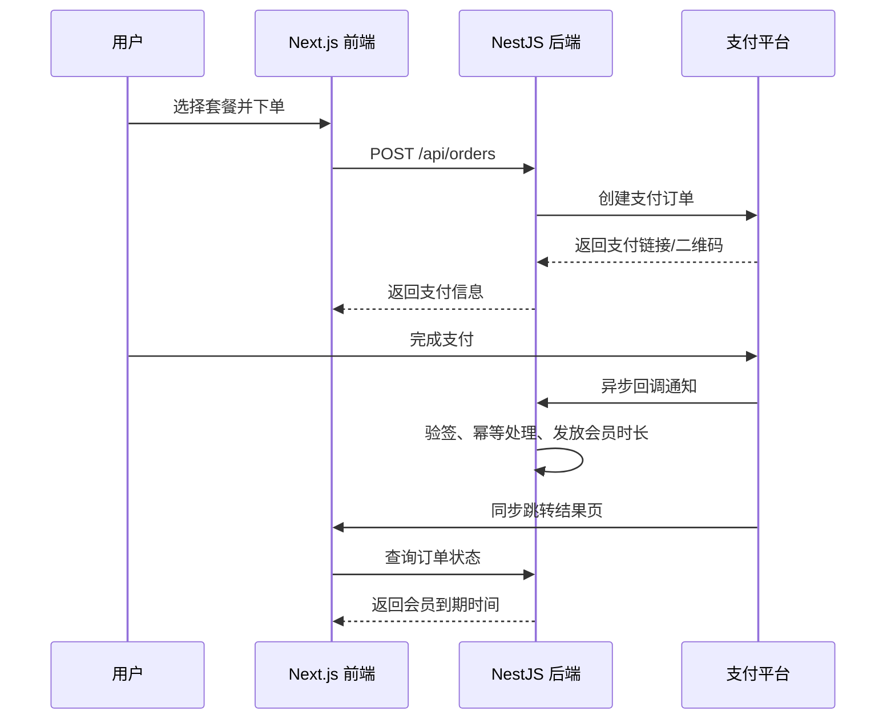
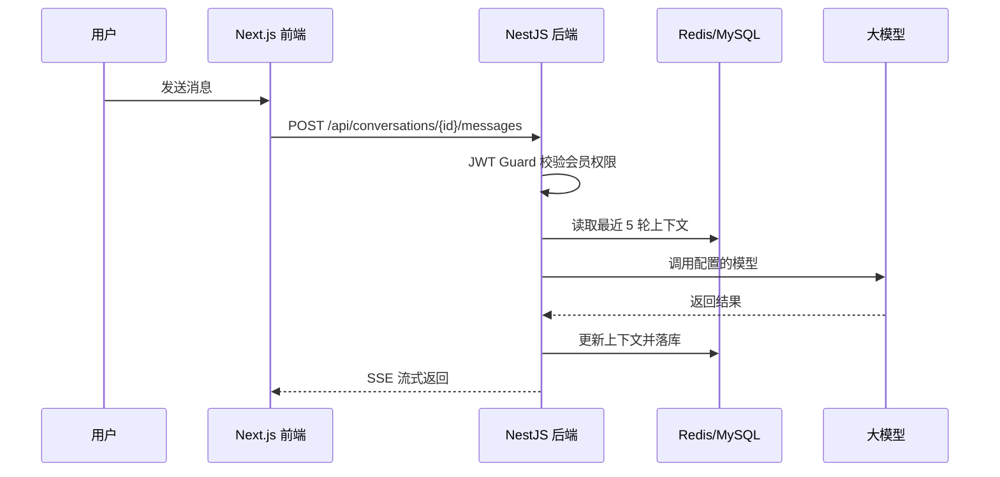

# 大模型对话系统开发方案

> 版本：v1.1  
> 日期：2026-09-12  
> 状态：待评审  
> 技术栈：Next.js + NestJS + TypeScript + MySQL + Redis  
> 目标：完成一个具备登录、会员、支付、模型配置、对话、历史记录和权限管控的完整大模型对话系统。

## 1. 项目概述

### 1.1 项目目标

建设一个前后端分离的大模型对话系统，支持：

- 用户名 + 密码注册登录，注册时实时校验用户名唯一性。
- 会员体系和充值能力，普通用户需充值成为会员后才能与大模型对话。
- 多模型配置与切换，管理员可维护模型 URL、Key 和模型名称。
- 对话历史管理，最多保留 5 轮对话上下文。
- 管理员后台，管理用户、套餐、支付配置、模型配置和订单。

### 1.2 核心需求清单

| 模块 | 需求说明 |
| --- | --- |
| 注册登录 | 用户名唯一、密码二次确认、JWT 登录 |
| 用户体系 | 普通用户、会员用户、管理员 |
| 会员体系 | 套餐金额、有效期、说明文字，套餐动态展示 |
| 支付系统 | 接入支付，配置信息可在后台维护 |
| 模型对话 | 对话页、历史记录、模型切换、5 轮上下文 |
| 模型管理 | 管理员配置模型 URL、Key、模型名 |
| 权限管控 | 只有会员或管理员可与模型对话 |

### 1.3 关键业务规则

- 普通用户登录后可浏览页面，但不能发送对话消息。
- 会员身份由“会员到期时间”决定，当前时间小于到期时间即视为会员。
- 管理员拥有会员的所有权益，并可访问管理后台。
- 套餐修改后，前端购买页必须动态展示最新套餐。
- 每个对话绑定一个模型配置；用户可切换模型开始新对话，或按产品要求切换后继续当前对话。
- 5 轮上下文指：最近 5 组“用户消息 + 助手回复”，加上当前用户输入，共 11 条消息作为请求上下文。

---

## 2. 技术选型

### 2.1 前端技术栈

| 层级 | 技术 | 说明 |
| --- | --- | --- |
| 框架 | Next.js + React + TypeScript | 使用 App Router |
| 用户端 UI | Tailwind CSS + 自定义聊天界面 | 对话体验优先 |
| 管理端 UI | Ant Design | 降低中后台开发成本 |
| 状态管理 | Zustand | 轻量管理登录态、会话状态 |
| 数据请求 | TanStack Query | 服务端状态、缓存、分页 |
| 表单校验 | React Hook Form + Zod | 登录、注册、后台表单 |
| 流式渲染 | SSE + fetch 流式读取 | 大模型流式输出 |

### 2.2 后端技术栈

| 层级 | 技术 | 说明 |
| --- | --- | --- |
| 框架 | NestJS + TypeScript | 模块化、依赖注入 |
| ORM | Prisma | 数据库建模与迁移 |
| 数据库 | MySQL 8.x | 业务数据 |
| 缓存 | Redis 7.x | 登录态、限流、上下文、幂等 |
| 鉴权 | JWT + Refresh Token | 配合 NestJS Guard |
| 日志 | Pino 或 Winston | 结构化日志 |
| 接口协议 | RESTful API | 前端与后端通信 |
| 流式输出 | SSE | 大模型对话流式返回 |
| AI 调用 | 自定义 HTTP 适配器 | 支持动态 URL、Key、模型名 |

### 2.3 技术选择原因

- Next.js 适合同时承载用户端和管理端，路由、鉴权、中后台页面管理成熟。
- TypeScript 统一前后端接口约束，降低联调成本。
- Ant Design 让后台管理开发更快，用户端聊天界面使用 Tailwind CSS 保持轻量。
- NestJS 适合权限、支付回调、模型路由、模块化开发。
- Prisma 便于数据库建模、迁移和类型安全。
- Redis 用于登录态、限流、上下文缓存、支付幂等控制。
- SSE 比 WebSocket 更适合当前“请求-流式响应”的对话模型。

### 2.4 部署形态

- 前端：Vercel 或 Nginx + Node.js 运行 Next.js。
- 后端：Docker + Node.js 运行 NestJS。
- 数据库：MySQL 8。
- 缓存：Redis 7。
- 文件与日志：本地挂载卷或对象存储。
- 生产环境必须启用 HTTPS，支付回调地址需公网可达。

---

## 3. 系统架构

### 3.1 总体架构图



### 3.2 模块划分

```text
前端
├── auth          登录、注册
├── chat          对话页、历史记录、模型切换
├── membership    会员套餐、充值、订单
├── profile       个人中心、会员状态
└── admin         后台管理

后端
├── auth          认证与授权
├── users         用户管理
├── member-plans  会员套餐
├── memberships   会员权益与到期时间
├── orders        订单管理
├── payment       支付渠道与回调
├── model-configs 模型配置管理
├── conversations 会话与消息
├── ai            大模型调用适配
└── common        统一响应、异常、拦截器、工具
```

### 3.3 关键流程

#### 注册登录



#### 会员充值与权益



#### 对话与上下文



---

## 4. 数据库设计

### 4.1 表清单

| 表名 | 说明 |
| --- | --- |
| `users` | 用户与登录信息 |
| `member_plans` | 会员充值套餐 |
| `user_memberships` | 用户会员状态 |
| `orders` | 充值订单 |
| `payment_configs` | 支付渠道配置 |
| `model_configs` | 大模型配置 |
| `conversations` | 对话会话 |
| `messages` | 对话消息 |
| `system_configs` | 系统级配置，可选 |
| `login_logs` | 登录日志，可选 |

### 4.2 核心表字段

#### `users`

| 字段 | 类型 | 说明 |
| --- | --- | --- |
| id | BIGINT | 主键 |
| username | VARCHAR(64) | 用户名，唯一索引 |
| password_hash | VARCHAR(255) | BCrypt 密码哈希 |
| role | VARCHAR(20) | `USER` / `ADMIN` |
| status | TINYINT | 1 正常，0 禁用 |
| created_at | DATETIME | 创建时间 |
| updated_at | DATETIME | 更新时间 |

#### `member_plans`

| 字段 | 类型 | 说明 |
| --- | --- | --- |
| id | BIGINT | 主键 |
| name | VARCHAR(64) | 套餐名称 |
| price | DECIMAL(10,2) | 套餐金额 |
| duration_days | INT | 有效天数，如 30、90 |
| duration_type | VARCHAR(20) | `MONTH_1` / `MONTH_3` / `CUSTOM` |
| description | VARCHAR(500) | 说明文字 |
| enabled | TINYINT | 是否上架 |
| sort | INT | 排序 |
| created_at | DATETIME | 创建时间 |
| updated_at | DATETIME | 更新时间 |

#### `user_memberships`

| 字段 | 类型 | 说明 |
| --- | --- | --- |
| id | BIGINT | 主键 |
| user_id | BIGINT | 用户 ID，唯一 |
| expire_at | DATETIME | 会员到期时间 |
| updated_at | DATETIME | 更新时间 |

#### `orders`

| 字段 | 类型 | 说明 |
| --- | --- | --- |
| id | BIGINT | 主键 |
| order_no | VARCHAR(64) | 业务订单号，唯一 |
| user_id | BIGINT | 用户 ID |
| plan_id | BIGINT | 套餐 ID |
| amount | DECIMAL(10,2) | 实付金额 |
| status | VARCHAR(20) | `CREATED`、`PENDING`、`PAID`、`CLOSED`、`REFUNDED` |
| payment_config_id | BIGINT | 使用的支付配置 |
| transaction_no | VARCHAR(128) | 支付平台流水号 |
| paid_at | DATETIME | 支付时间 |
| expire_at | DATETIME | 订单过期时间 |
| created_at | DATETIME | 创建时间 |
| updated_at | DATETIME | 更新时间 |

#### `payment_configs`

| 字段 | 类型 | 说明 |
| --- | --- | --- |
| id | BIGINT | 主键 |
| name | VARCHAR(64) | 配置名称 |
| provider | VARCHAR(32) | 支付渠道标识 |
| merchant_id | VARCHAR(128) | 商户号 |
| app_id | VARCHAR(128) | 应用 ID |
| app_secret | VARCHAR(255) | 应用密钥，可加密存储 |
| api_key | VARCHAR(255) | API Key，可加密存储 |
| gateway_url | VARCHAR(255) | 支付网关地址 |
| notify_url | VARCHAR(255) | 异步回调地址 |
| return_url | VARCHAR(255) | 同步跳转地址 |
| enabled | TINYINT | 是否启用 |
| created_at | DATETIME | 创建时间 |
| updated_at | DATETIME | 更新时间 |

#### `model_configs`

| 字段 | 类型 | 说明 |
| --- | --- | --- |
| id | BIGINT | 主键 |
| name | VARCHAR(64) | 前台展示名称 |
| provider | VARCHAR(32) | 服务商，如 `openai_compatible` |
| base_url | VARCHAR(255) | API 地址 |
| api_key | VARCHAR(255) | API Key，可加密存储 |
| model_name | VARCHAR(128) | 实际请求的模型名 |
| max_tokens | INT | 单次最大 Token |
| temperature | DECIMAL(3,2) | 采样温度 |
| enabled | TINYINT | 是否启用 |
| sort | INT | 排序 |
| created_at | DATETIME | 创建时间 |
| updated_at | DATETIME | 更新时间 |

#### `conversations`

| 字段 | 类型 | 说明 |
| --- | --- | --- |
| id | BIGINT | 主键 |
| user_id | BIGINT | 用户 ID |
| model_config_id | BIGINT | 当前模型配置 ID |
| title | VARCHAR(255) | 会话标题 |
| last_message_at | DATETIME | 最后消息时间 |
| created_at | DATETIME | 创建时间 |
| updated_at | DATETIME | 更新时间 |

#### `messages`

| 字段 | 类型 | 说明 |
| --- | --- | --- |
| id | BIGINT | 主键 |
| conversation_id | BIGINT | 会话 ID |
| role | VARCHAR(20) | `system` / `user` / `assistant` |
| content | TEXT | 消息内容 |
| model_name | VARCHAR(128) | 实际使用的模型名 |
| token_count | INT | 消耗 Token 估算 |
| created_at | DATETIME | 创建时间 |

### 4.3 索引建议

- `users.username` 唯一索引。
- `user_memberships.user_id` 唯一索引。
- `orders.order_no` 唯一索引。
- `orders.user_id + status` 联合索引。
- `conversations.user_id + last_message_at` 联合索引。
- `messages.conversation_id + created_at` 联合索引。

---

## 5. 后端开发方案

### 5.1 后端项目结构

```text
backend
├── package.json
├── tsconfig.json
├── nest-cli.json
├── prisma
│   ├── schema.prisma
│   └── migrations
└── src
    ├── main.ts
    ├── app.module.ts
    ├── common
    │   ├── interceptors
    │   │   ├── response.interceptor.ts
    │   │   └── logging.interceptor.ts
    │   ├── filters
    │   │   └── http-exception.filter.ts
    │   ├── decorators
    │   │   ├── current-user.decorator.ts
    │   │   └── roles.decorator.ts
    │   └── guards
    │       ├── jwt-auth.guard.ts
    │       └── roles.guard.ts
    ├── config
    │   ├── configuration.ts
    │   └── redis.module.ts
    ├── prisma
    │   ├── prisma.module.ts
    │   └── prisma.service.ts
    ├── auth
    │   ├── auth.module.ts
    │   ├── auth.controller.ts
    │   ├── auth.service.ts
    │   ├── jwt.strategy.ts
    │   ├── refresh-token.strategy.ts
    │   └── dto
    ├── users
    │   ├── users.module.ts
    │   ├── users.controller.ts
    │   ├── users.service.ts
    │   └── dto
    ├── member-plans
    │   ├── member-plans.module.ts
    │   ├── member-plans.controller.ts
    │   └── member-plans.service.ts
    ├── memberships
    │   ├── memberships.module.ts
    │   ├── memberships.controller.ts
    │   └── memberships.service.ts
    ├── orders
    │   ├── orders.module.ts
    │   ├── orders.controller.ts
    │   ├── orders.service.ts
    │   └── dto
    ├── payment
    │   ├── payment.module.ts
    │   ├── payment.controller.ts
    │   ├── payment.service.ts
    │   ├── payment.strategy.ts
    │   └── dto
    ├── model-configs
    │   ├── model-configs.module.ts
    │   ├── model-configs.controller.ts
    │   └── model-configs.service.ts
    ├── conversations
    │   ├── conversations.module.ts
    │   ├── conversations.controller.ts
    │   ├── conversations.service.ts
    │   └── messages.service.ts
    └── ai
        ├── ai.module.ts
        ├── ai.service.ts
        ├── ai-client.interface.ts
        └── openai-compatible.client.ts
```

### 5.2 认证与授权

- 密码使用 BCrypt 加密，数据库不保存明文。
- 登录成功签发 Access Token，有效期建议 2 小时。
- 同时签发 Refresh Token，用于延长登录态，生产建议存 Redis。
- 接口通过 NestJS Guard + JWT Strategy 校验。
- 角色划分：
  - `USER`：普通用户。
  - `ADMIN`：管理员。
- 权益划分：
  - 普通用户：登录、浏览套餐、查看个人中心，不能对话。
  - 会员用户：普通用户权益 + 对话。
  - 管理员：会员权益 + 管理后台。

### 5.3 用户注册与登录接口

- 用户名唯一性检测：
  - `GET /api/auth/check-username?username=xxx`
  - 前端在输入框失焦或输入停顿后调用。
  - 重复时返回 `available: false`，前端显示骰子按钮。
- 注册：
  - `POST /api/auth/register`
  - 后端使用 DTO + class-validator / Zod 校验用户名唯一和两次密码一致。
- 登录：
  - `POST /api/auth/login`
  - 返回 Access Token、Refresh Token 和基础用户信息。

### 5.4 会员体系

- 管理员可增删改查套餐，套餐字段包含：金额、有效期、说明文字。
- 有效期建议以“天数”存储，同时保留 `MONTH_1`、`MONTH_3` 类型用于前端展示。
- 用户端套餐接口只返回 `enabled = 1` 的套餐。
- 购买成功后，会员到期时间按规则累加：
  - 当前已过期：`到期时间 = 当前时间 + 套餐天数`。
  - 当前未过期：`到期时间 = 原到期时间 + 套餐天数`。

### 5.5 支付对接

- 支付文档：https://pay.playoffer.cn/doc/index.html
- 支付配置信息统一从 `payment_configs` 表读取，代码中不写死。
- 支付配置字段留空时，接口应返回“支付未配置”的友好提示。
- 支付流程：
  1. 用户选择套餐，后端创建订单。
  2. 后端根据启用的支付配置调用支付平台。
  3. 前端跳转或展示支付二维码。
  4. 支付平台异步回调后端。
  5. 后端验签、幂等处理、更新订单、发放会员时长。
  6. 前端同步跳转后查询订单状态并刷新会员状态。
- 支付回调必须：
  - 校验签名。
  - 使用 `order_no` 或 Redis 幂等锁做幂等。
  - 订单状态更新和会员时长发放放在同一事务。
  - 回调接口暴露为公网可访问地址。

### 5.6 模型管理

- 管理员可维护多个模型配置。
- 每个配置包含：展示名称、URL、Key、实际模型名、最大 Token、温度、是否启用。
- 用户端只获取 `enabled = 1` 的模型列表，接口不返回 Key。
- 模型切换：
  - 创建新会话时选择模型。
  - 历史会话使用创建时绑定的模型。
  - 若产品要求切换当前会话模型，可增加“切换模型后生成新会话”的策略。

### 5.7 对话与上下文管理

#### 消息发送流程

1. 用户发送消息。
2. NestJS Guard 校验登录态和会员身份。
3. 校验 `conversation_id` 属于当前用户。
4. 保存用户消息。
5. 读取该会话最近 5 轮上下文。
6. 组装模型请求并调用对应模型配置。
7. 将助手回复保存到数据库。
8. 通过 SSE 流式返回前端。

#### 上下文规则

- 每轮 = 1 条用户消息 + 1 条助手回复。
- 最多取最近 5 轮，即最近 10 条消息，再加当前用户消息。
- 不参与上下文的旧消息仍保留在数据库中，供历史记录查看。
- 系统提示词可在后端配置，默认放在请求消息列表最前面。

#### 上下文存储

- 持久化：全部消息写入 MySQL。
- 加速：可使用 Redis 缓存会话最近 5 轮消息，Key 如 `chat:context:{conversationId}`。
- 缓存过期或未命中时从数据库回源。

#### 流式输出

- 推荐使用 SSE，前端通过 `fetch` 或 `EventSource` 读取。
- 若模型接口支持流式，后端透传并转换为前端 SSE。
- 若模型接口不支持流式，可先完整调用再一次性返回。
- 超时时间建议 60 秒，前端需处理中断和重试。

### 5.8 历史记录管理

- 会话列表按最后消息时间倒序。
- 支持分页。
- 支持新建会话、重命名、删除。
- 删除会话时，消息记录可逻辑删除或物理删除，需明确数据保留策略。

### 5.9 权限控制建议

```text
普通用户
├── 登录/注册
├── 查看会员套餐
├── 查看个人会员状态
└── 发起充值

会员用户
├── 普通用户全部权限
└── 创建会话、发送消息、管理历史记录

管理员
├── 会员用户全部权限
├── 用户管理
├── 套餐管理
├── 支付配置管理
├── 模型配置管理
└── 订单管理
```

---

## 6. API 设计

统一前缀：`/api`

### 6.1 认证

| 方法 | 路径 | 说明 |
| --- | --- | --- |
| POST | `/auth/register` | 注册 |
| POST | `/auth/login` | 登录 |
| POST | `/auth/logout` | 退出登录 |
| GET | `/auth/check-username` | 校验用户名是否可用 |
| POST | `/auth/refresh` | 刷新 Token |

### 6.2 用户与会员

| 方法 | 路径 | 说明 |
| --- | --- | --- |
| GET | `/users/me` | 获取当前用户信息 |
| PUT | `/users/me` | 修改个人信息 |
| GET | `/memberships/me` | 获取当前会员状态 |
| GET | `/member-plans` | 获取上架套餐 |

### 6.3 订单与支付

| 方法 | 路径 | 说明 |
| --- | --- | --- |
| POST | `/orders` | 创建充值订单 |
| GET | `/orders/{orderNo}` | 查询订单 |
| GET | `/orders` | 我的订单列表 |
| POST | `/payment/callback` | 支付异步回调 |
| GET | `/payment/return` | 支付同步跳转 |

### 6.4 模型与对话

| 方法 | 路径 | 说明 |
| --- | --- | --- |
| GET | `/models` | 获取可用模型列表 |
| POST | `/conversations` | 创建会话 |
| GET | `/conversations` | 会话列表 |
| PUT | `/conversations/{id}` | 重命名会话 |
| DELETE | `/conversations/{id}` | 删除会话 |
| GET | `/conversations/{id}/messages` | 获取历史消息 |
| POST | `/conversations/{id}/messages` | 发送消息，SSE 返回 |

### 6.5 管理端

| 方法 | 路径 | 说明 |
| --- | --- | --- |
| GET/POST/PUT/DELETE | `/admin/users` | 用户管理 |
| GET/POST/PUT/DELETE | `/admin/member-plans` | 套餐管理 |
| GET/POST/PUT/DELETE | `/admin/model-configs` | 模型配置管理 |
| GET/POST/PUT/DELETE | `/admin/payment-configs` | 支付配置管理 |
| GET | `/admin/orders` | 订单列表 |
| GET | `/admin/dashboard` | 后台统计 |

### 6.6 统一响应结构

```json
{
  "code": 0,
  "message": "success",
  "data": {}
}
```

- `code = 0` 表示成功。
- 业务错误使用非 0 错误码。
- HTTP 状态码用于网络层语义，业务错误统一返回 200 或 4xx，需保持一致。

---

## 7. 前端开发方案

### 7.1 前端项目结构

```text
frontend
├── package.json
├── next.config.ts
├── tailwind.config.ts
├── tsconfig.json
├── middleware.ts
└── src
    ├── app
    │   ├── layout.tsx
    │   ├── page.tsx
    │   ├── (auth)
    │   │   ├── login/page.tsx
    │   │   └── register/page.tsx
    │   ├── (user)
    │   │   ├── chat/page.tsx
    │   │   ├── membership/page.tsx
    │   │   └── profile/page.tsx
    │   └── admin
    │       ├── layout.tsx
    │       ├── dashboard/page.tsx
    │       ├── users/page.tsx
    │       ├── plans/page.tsx
    │       ├── models/page.tsx
    │       ├── payment/page.tsx
    │       └── orders/page.tsx
    ├── components
    │   ├── chat
    │   │   ├── ChatSidebar.tsx
    │   │   ├── ChatMessageList.tsx
    │   │   ├── ChatInput.tsx
    │   │   └── ModelSelector.tsx
    │   ├── membership
    │   │   ├── PlanCard.tsx
    │   │   └── PaymentDialog.tsx
    │   ├── auth
    │   │   ├── RegisterForm.tsx
    │   │   └── LoginForm.tsx
    │   └── ui
    │       ├── Button.tsx
    │       ├── Input.tsx
    │       └── Dialog.tsx
    ├── lib
    │   ├── api
    │   │   ├── client.ts
    │   │   ├── auth.ts
    │   │   ├── chat.ts
    │   │   ├── member.ts
    │   │   └── admin.ts
    │   ├── stores
    │   │   ├── auth-store.ts
    │   │   └── chat-store.ts
    │   ├── hooks
    │   │   ├── use-auth.ts
    │   │   ├── use-conversations.ts
    │   │   └── use-sse-chat.ts
    │   ├── validation
    │   │   ├── login-schema.ts
    │   │   └── register-schema.ts
    │   └── utils
    │       ├── format.ts
    │       └── sse.ts
    └── types
        ├── api.ts
        ├── chat.ts
        └── user.ts
```

### 7.2 页面规划

#### 登录页

- 用户名、密码输入。
- 使用 React Hook Form + Zod 校验。
- 登录成功后跳转到对话页或套餐页。

#### 注册页

- 用户名输入框失焦或输入后调用唯一性检测。
- 用户名重复时，输入框右侧出现骰子按钮。
- 点击骰子按钮，在用户名后追加随机数字或随机字符串，并重新校验。
- 密码输入框和确认密码输入框。
- 两次密码一致才能提交注册。

#### 对话页

- 左侧：历史会话列表，支持新建、重命名、删除。
- 右侧：大块聊天消息区域。
- 底部：输入框。
- 输入框左侧：模型选择器。
- 普通用户进入对话页时，显示会员引导，禁止发送消息。
- 会员用户可正常发送消息并查看流式回复。
- 用户端使用 Tailwind CSS 构建自定义聊天界面。

#### 会员页

- 展示套餐卡片：金额、有效期、说明。
- 点击充值，创建订单并跳转支付。
- 支付成功后刷新会员状态。

#### 个人中心

- 展示用户名、角色、会员到期时间。
- 管理员显示进入后台入口。

#### 管理后台

- 使用 Ant Design 组件。
- 仪表盘：用户数、订单数、会员数等统计。
- 用户管理：查询、禁用、修改角色。
- 套餐管理：金额、有效期、说明、上下架。
- 支付管理：支付渠道配置，密钥需脱敏展示。
- 模型管理：URL、Key、模型名、参数、上下架。
- 订单管理：查询订单和支付状态。

### 7.3 前端权限控制

- Next.js `middleware.ts` 做轻量级登录态和角色路由守卫。
- 服务端或客户端读取登录态，未登录跳转登录页。
- 管理端路由要求角色为 `ADMIN`。
- 真正的权限控制以后端 NestJS Guard 为准，前端控制只用于体验。
- 会员状态由接口返回，前端控制是否显示发送入口，后端仍需强制校验。
- Access Token 存储需兼顾安全，生产环境考虑 HttpOnly Cookie 或安全存储方案。

### 7.4 前端交互细节

- 用户名唯一检测需防抖，避免频繁请求。
- 密码不一致时实时提示。
- 流式回复使用分段追加渲染。
- 消息发送中禁止重复提交。
- 会话列表使用 TanStack Query 管理缓存与分页。
- 对话列表使用虚拟滚动，避免消息过多导致卡顿。
- 移动端需做响应式适配。

---

## 8. 非功能需求

### 8.1 安全

- 密码 BCrypt 加密。
- JWT 设置合理过期时间，Refresh Token 可轮换。
- 管理端接口二次校验角色。
- 支付密钥和模型 Key 不返回前端。
- 支付回调验签。
- 防止越权：用户只能操作自己的会话和订单。
- 输入防 XSS，Prisma 参数化查询防 SQL 注入。
- 对登录、注册、支付回调做限流。

### 8.2 性能

- 用户列表、会话列表、订单列表分页。
- 消息内容建议分页加载，历史消息可按需加载。
- 最近上下文用 Redis 缓存。
- 模型调用异步化，避免阻塞其他请求。
- SSE 长连接需配置合理超时。

### 8.3 可用性与一致性

- 支付回调失败需有重试机制。
- 订单幂等。
- 会员发放与订单更新使用事务。
- 关键操作记录日志。

### 8.4 可维护性

- 后端统一异常处理和响应格式。
- 前端统一请求封装和类型定义。
- 使用环境变量管理数据库、Redis、支付等配置。
- Prisma Migration 管理数据库变更。
- 配置与代码分离。

---

## 9. 开发计划

### 9.1 里程碑

| 阶段 | 内容 | 产出 |
| --- | --- | --- |
| M1 | 项目初始化 | Next.js/NestJS 骨架、Prisma 模型、Redis 接入 |
| M2 | 登录注册 | 用户表、认证接口、登录/注册页 |
| M3 | 会员套餐 | 套餐表、套餐接口、会员页 |
| M4 | 支付接入 | 订单、支付配置、回调、会员发放 |
| M5 | 模型对话 | 模型配置、会话、消息、SSE、对话页 |
| M6 | 管理后台 | 用户/套餐/模型/支付/订单管理 |
| M7 | 联调与测试 | 全流程验证、修复 |
| M8 | 部署上线 | Vercel/Nginx、Docker、HTTPS |

### 9.2 开发任务拆分

- 后端 NestJS：
  - 初始化项目、Prisma Schema、公共模块、日志。
  - 实现注册登录和 JWT + Refresh Token。
  - 实现会员套餐和会员状态。
  - 实现订单和支付适配器。
  - 实现模型配置和 AI 调用。
  - 实现会话、消息、上下文。
  - 实现管理端接口。
- 前端 Next.js：
  - 初始化项目、路由、Zustand、TanStack Query、请求封装。
  - 实现登录注册页。
  - 实现会员页和支付跳转。
  - 实现对话页、SSE 流式渲染和历史记录。
  - 实现管理后台。

---

## 10. 验收标准

- 注册时用户名可实时查重，重复时出现骰子按钮。
- 密码两次输入不一致时无法注册。
- 用户名唯一，数据库存在唯一约束。
- 登录成功后能正常进入系统。
- 普通用户不能发送消息，会员和管理员可以。
- 管理后台可新增、编辑、上下架套餐。
- 用户端套餐会动态更新。
- 管理员可配置模型 URL、Key 和模型名。
- 对话页可选择可用模型。
- 对话历史可查看、新建、重命名、删除。
- 模型请求最多携带最近 5 轮上下文。
- 支付配置可为空，不阻塞其他功能。
- 支付成功后会员时长正确累加。
- 管理员拥有会员全部权益。

---

## 11. 风险与注意事项

- 支付文档细节需在开发 M4 阶段前确认，尤其是签名、回调和退款流程。
- 不同模型厂商接口可能不兼容，AI 层需做成可扩展适配器。
- 5 轮上下文可能超出部分模型的 Token 限制，需限制单条消息长度或做 Token 截断。
- SSE 在部分反向代理下需要关闭缓冲。
- 生产环境必须使用 HTTPS，支付回调地址需公网可访问。
- 支付密钥和模型 Key 必须加密存储，前端禁止获取。
- Next.js 与 NestJS 分属两个 Node 服务，需统一环境变量和部署配置。

---

## 12. 下一步

1. 确认 Next.js + NestJS 技术栈是否最终确定。
2. 确认支付平台的具体接口细节。
3. 初始化前后端项目和 Prisma 数据库模型。
4. 按 M1 开始实现基础骨架和登录模块。