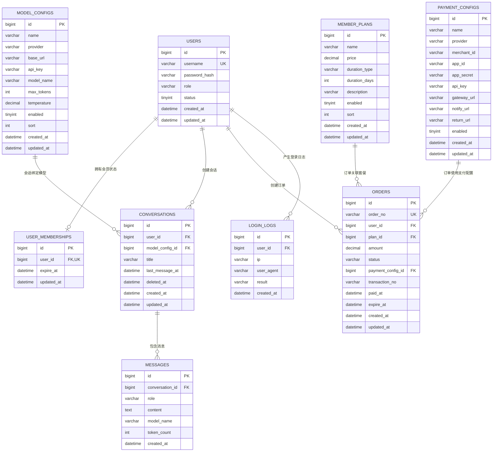

# 大模型对话系统数据库设计与接口文档

> 版本：v1.0  
> 日期：2026-09-12  
> 所属方案：`docs/开发方案.md`  
> 技术栈：Next.js + NestJS + TypeScript + Prisma + MySQL + Redis

本文档细化为两部分：数据库 ER 图与表结构、前后端接口契约。

---

## 1. 数据库 ER 图



### 1.1 关系说明

| 关系 | 基数 | 说明 |
| --- | --- | --- |
| `USERS` -> `USER_MEMBERSHIPS` | 1:0..1 | 一个用户最多一条会员状态 |
| `USERS` -> `CONVERSATIONS` | 1:N | 一个用户可有多个会话 |
| `USERS` -> `ORDERS` | 1:N | 一个用户可有多笔订单 |
| `USERS` -> `LOGIN_LOGS` | 1:N | 一个用户可有多条登录日志 |
| `MEMBER_PLANS` -> `ORDERS` | 1:N | 一个套餐可被多笔订单引用 |
| `PAYMENT_CONFIGS` -> `ORDERS` | 1:N | 一个支付配置可被多笔订单使用 |
| `MODEL_CONFIGS` -> `CONVERSATIONS` | 1:N | 一个模型可绑定多个会话 |
| `CONVERSATIONS` -> `MESSAGES` | 1:N | 一个会话包含多条消息 |

---

## 2. 数据表详细设计

### 2.1 `users` 用户表

| 字段 | 类型 | 约束 | 默认值 | 说明 |
| --- | --- | --- | --- | --- |
| id | BIGINT UNSIGNED | PK, AUTO_INCREMENT | - | 主键 |
| username | VARCHAR(64) | UNIQUE, NOT NULL | - | 登录用户名 |
| password_hash | VARCHAR(255) | NOT NULL | - | BCrypt 密码哈希 |
| role | ENUM('USER','ADMIN') | NOT NULL | USER | 用户角色 |
| status | TINYINT(1) | NOT NULL | 1 | 1 正常，0 禁用 |
| created_at | DATETIME(3) | NOT NULL | CURRENT_TIMESTAMP(3) | 创建时间 |
| updated_at | DATETIME(3) | NOT NULL | CURRENT_TIMESTAMP(3) | 更新时间 |

索引：

- `uk_username`：`username` 唯一索引。
- `idx_users_status`：`status`。

### 2.2 `member_plans` 会员套餐表

| 字段 | 类型 | 约束 | 默认值 | 说明 |
| --- | --- | --- | --- | --- |
| id | BIGINT UNSIGNED | PK, AUTO_INCREMENT | - | 主键 |
| name | VARCHAR(64) | NOT NULL | - | 套餐名称 |
| price | DECIMAL(10,2) | NOT NULL | 0.00 | 套餐金额 |
| duration_type | ENUM('MONTH_1','MONTH_3','CUSTOM') | NOT NULL | MONTH_1 | 有效期类型 |
| duration_days | INT UNSIGNED | NOT NULL | 30 | 有效天数 |
| description | VARCHAR(500) | NULL | - | 说明文字 |
| enabled | TINYINT(1) | NOT NULL | 1 | 是否上架 |
| sort | INT | NOT NULL | 0 | 排序，越小越靠前 |
| created_at | DATETIME(3) | NOT NULL | CURRENT_TIMESTAMP(3) | 创建时间 |
| updated_at | DATETIME(3) | NOT NULL | CURRENT_TIMESTAMP(3) | 更新时间 |

索引：

- `idx_plan_enabled_sort`：`enabled, sort`。

### 2.3 `user_memberships` 用户会员状态表

| 字段 | 类型 | 约束 | 默认值 | 说明 |
| --- | --- | --- | --- | --- |
| id | BIGINT UNSIGNED | PK, AUTO_INCREMENT | - | 主键 |
| user_id | BIGINT UNSIGNED | UNIQUE, NOT NULL | - | 用户 ID |
| expire_at | DATETIME(3) | NOT NULL | - | 会员到期时间 |
| updated_at | DATETIME(3) | NOT NULL | CURRENT_TIMESTAMP(3) | 更新时间 |

外键：

- `user_id` 关联 `users.id`，`ON DELETE CASCADE`。

索引：

- `uk_membership_user`：`user_id` 唯一索引。
- `idx_membership_expire`：`expire_at`。

### 2.4 `orders` 订单表

| 字段 | 类型 | 约束 | 默认值 | 说明 |
| --- | --- | --- | --- | --- |
| id | BIGINT UNSIGNED | PK, AUTO_INCREMENT | - | 主键 |
| order_no | VARCHAR(64) | UNIQUE, NOT NULL | - | 业务订单号 |
| user_id | BIGINT UNSIGNED | NOT NULL | - | 下单用户 ID |
| plan_id | BIGINT UNSIGNED | NOT NULL | - | 套餐 ID |
| plan_name | VARCHAR(64) | NOT NULL | - | 下单时套餐名称快照 |
| duration_days | INT UNSIGNED | NOT NULL | - | 下单时有效天数快照 |
| amount | DECIMAL(10,2) | NOT NULL | - | 支付金额 |
| status | ENUM('CREATED','PENDING','PAID','CLOSED','REFUNDED') | NOT NULL | CREATED | 订单状态 |
| payment_config_id | BIGINT UNSIGNED | NULL | - | 使用的支付配置 ID |
| transaction_no | VARCHAR(128) | NULL | - | 支付平台流水号 |
| paid_at | DATETIME(3) | NULL | - | 支付成功时间 |
| expire_at | DATETIME(3) | NULL | - | 订单超时时间 |
| created_at | DATETIME(3) | NOT NULL | CURRENT_TIMESTAMP(3) | 创建时间 |
| updated_at | DATETIME(3) | NOT NULL | CURRENT_TIMESTAMP(3) | 更新时间 |

外键：

- `user_id` 关联 `users.id`。
- `plan_id` 关联 `member_plans.id`。
- `payment_config_id` 关联 `payment_configs.id`。

索引：

- `uk_order_no`：`order_no` 唯一索引。
- `idx_orders_user_status`：`user_id, status`。
- `idx_orders_created_at`：`created_at`。

### 2.5 `payment_configs` 支付配置表

| 字段 | 类型 | 约束 | 默认值 | 说明 |
| --- | --- | --- | --- | --- |
| id | BIGINT UNSIGNED | PK, AUTO_INCREMENT | - | 主键 |
| name | VARCHAR(64) | NOT NULL | - | 配置名称 |
| provider | VARCHAR(32) | NOT NULL | - | 支付渠道标识 |
| merchant_id | VARCHAR(128) | NULL | - | 商户号 |
| app_id | VARCHAR(128) | NULL | - | 应用 ID |
| app_secret | VARCHAR(255) | NULL | - | 应用密钥，加密存储 |
| api_key | VARCHAR(255) | NULL | - | API Key，加密存储 |
| gateway_url | VARCHAR(255) | NULL | - | 支付网关地址 |
| notify_url | VARCHAR(255) | NULL | - | 异步回调地址 |
| return_url | VARCHAR(255) | NULL | - | 同步跳转地址 |
| enabled | TINYINT(1) | NOT NULL | 1 | 是否启用 |
| created_at | DATETIME(3) | NOT NULL | CURRENT_TIMESTAMP(3) | 创建时间 |
| updated_at | DATETIME(3) | NOT NULL | CURRENT_TIMESTAMP(3) | 更新时间 |

索引：

- `idx_payment_enabled`：`enabled`。

### 2.6 `model_configs` 模型配置表

| 字段 | 类型 | 约束 | 默认值 | 说明 |
| --- | --- | --- | --- | --- |
| id | BIGINT UNSIGNED | PK, AUTO_INCREMENT | - | 主键 |
| name | VARCHAR(64) | NOT NULL | - | 前台展示名称 |
| provider | ENUM('OPENAI_COMPATIBLE','CUSTOM') | NOT NULL | OPENAI_COMPATIBLE | 模型服务类型 |
| base_url | VARCHAR(255) | NOT NULL | - | API 地址 |
| api_key | VARCHAR(255) | NULL | - | API Key，加密存储 |
| model_name | VARCHAR(128) | NOT NULL | - | 实际请求模型名 |
| max_tokens | INT UNSIGNED | NOT NULL | 2048 | 单次最大 Token |
| temperature | DECIMAL(3,2) | NOT NULL | 0.70 | 采样温度 |
| enabled | TINYINT(1) | NOT NULL | 1 | 是否启用 |
| sort | INT | NOT NULL | 0 | 排序 |
| created_at | DATETIME(3) | NOT NULL | CURRENT_TIMESTAMP(3) | 创建时间 |
| updated_at | DATETIME(3) | NOT NULL | CURRENT_TIMESTAMP(3) | 更新时间 |

索引：

- `idx_model_enabled_sort`：`enabled, sort`。

### 2.7 `conversations` 会话表

| 字段 | 类型 | 约束 | 默认值 | 说明 |
| --- | --- | --- | --- | --- |
| id | BIGINT UNSIGNED | PK, AUTO_INCREMENT | - | 主键 |
| user_id | BIGINT UNSIGNED | NOT NULL | - | 用户 ID |
| model_config_id | BIGINT UNSIGNED | NOT NULL | - | 模型配置 ID |
| title | VARCHAR(255) | NOT NULL | 新对话 | 会话标题 |
| last_message_at | DATETIME(3) | NULL | - | 最后消息时间 |
| deleted_at | DATETIME(3) | NULL | - | 软删除时间 |
| created_at | DATETIME(3) | NOT NULL | CURRENT_TIMESTAMP(3) | 创建时间 |
| updated_at | DATETIME(3) | NOT NULL | CURRENT_TIMESTAMP(3) | 更新时间 |

外键：

- `user_id` 关联 `users.id`。
- `model_config_id` 关联 `model_configs.id`。

索引：

- `idx_conversation_user_updated`：`user_id, last_message_at DESC`。
- `idx_conversation_user_deleted`：`user_id, deleted_at`。

### 2.8 `messages` 消息表

| 字段 | 类型 | 约束 | 默认值 | 说明 |
| --- | --- | --- | --- | --- |
| id | BIGINT UNSIGNED | PK, AUTO_INCREMENT | - | 主键 |
| conversation_id | BIGINT UNSIGNED | NOT NULL | - | 会话 ID |
| role | ENUM('SYSTEM','USER','ASSISTANT') | NOT NULL | - | 消息角色 |
| content | TEXT | NOT NULL | - | 消息内容 |
| model_name | VARCHAR(128) | NULL | - | 实际使用的模型名 |
| token_count | INT UNSIGNED | NOT NULL | 0 | 消耗 Token 估算 |
| created_at | DATETIME(3) | NOT NULL | CURRENT_TIMESTAMP(3) | 创建时间 |

外键：

- `conversation_id` 关联 `conversations.id`，`ON DELETE CASCADE`。

索引：

- `idx_message_conversation_created`：`conversation_id, created_at`。

### 2.9 `login_logs` 登录日志表（可选）

| 字段 | 类型 | 约束 | 默认值 | 说明 |
| --- | --- | --- | --- | --- |
| id | BIGINT UNSIGNED | PK, AUTO_INCREMENT | - | 主键 |
| user_id | BIGINT UNSIGNED | NULL | - | 用户 ID，登录失败可为空 |
| ip | VARCHAR(64) | NULL | - | 登录 IP |
| user_agent | VARCHAR(255) | NULL | - | 浏览器标识 |
| result | ENUM('SUCCESS','FAILED') | NOT NULL | - | 登录结果 |
| created_at | DATETIME(3) | NOT NULL | CURRENT_TIMESTAMP(3) | 创建时间 |

### 2.10 `system_configs` 系统配置表（可选）

| 字段 | 类型 | 约束 | 默认值 | 说明 |
| --- | --- | --- | --- | --- |
| id | BIGINT UNSIGNED | PK, AUTO_INCREMENT | - | 主键 |
| config_key | VARCHAR(64) | UNIQUE, NOT NULL | - | 配置键 |
| config_value | TEXT | NULL | - | 配置值 |
| description | VARCHAR(255) | NULL | - | 配置说明 |
| updated_at | DATETIME(3) | NOT NULL | CURRENT_TIMESTAMP(3) | 更新时间 |

---

## 3. Prisma 模型映射建议

- `users` 对应 `User`，使用 `@map("users")`。
- `member_plans` 对应 `MemberPlan`。
- `user_memberships` 对应 `UserMembership`。
- `orders` 对应 `Order`，避免与 Prisma 关键字冲突可命名 `Order` 并映射表名。
- `payment_configs` 对应 `PaymentConfig`。
- `model_configs` 对应 `ModelConfig`。
- `conversations` 对应 `Conversation`。
- `messages` 对应 `Message`。

建议在 Prisma Schema 中通过 `enum` 定义角色、订单状态、消息角色、套餐类型和模型服务类型。

---

## 4. 接口通用约定

### 4.1 基础信息

- Base URL：`https://your-domain.com/api`
- 协议：RESTful API
- 数据格式：`application/json; charset=utf-8`
- 流式接口：`text/event-stream`
- 认证方式：`Authorization: Bearer <accessToken>`

### 4.2 通用响应结构

```json
{
  "code": 0,
  "message": "success",
  "data": {}
}
```

| 字段 | 类型 | 说明 |
| --- | --- | --- |
| code | number | 0 成功，非 0 业务错误 |
| message | string | 提示信息 |
| data | any | 返回数据 |

### 4.3 分页约定

请求参数：

| 参数 | 类型 | 必填 | 默认值 | 说明 |
| --- | --- | --- | --- | --- |
| page | number | 否 | 1 | 页码，从 1 开始 |
| pageSize | number | 否 | 20 | 每页条数，最大 100 |

分页响应：

```json
{
  "list": [],
  "total": 0,
  "page": 1,
  "pageSize": 20
}
```

### 4.4 错误码

| code | HTTP 状态 | 说明 |
| --- | --- | --- |
| 0 | 200 | 成功 |
| 10001 | 400 | 参数校验失败 |
| 10002 | 401 | 未登录或 Token 失效 |
| 10003 | 403 | 无权限 |
| 10004 | 404 | 资源不存在 |
| 10005 | 409 | 用户名已存在 |
| 10006 | 409 | 订单状态冲突 |
| 10007 | 402 | 非会员，无法对话 |
| 10008 | 503 | 支付未配置 |
| 10009 | 502 | 模型调用失败 |
| 10010 | 429 | 请求过于频繁 |
| 50000 | 500 | 服务端错误 |

---

## 5. 认证接口

### 5.1 校验用户名是否可用

`GET /auth/check-username`

权限：公开

查询参数：

| 参数 | 类型 | 必填 | 说明 |
| --- | --- | --- | --- |
| username | string | 是 | 待校验用户名 |

响应示例：

```json
{
  "code": 0,
  "message": "success",
  "data": {
    "username": "demo",
    "available": false,
    "suggestions": ["demo123", "demo_2026"]
  }
}
```

说明：

- `available = true` 表示可用。
- 重复时可返回随机后缀建议，前端用于骰子按钮。

### 5.2 注册

`POST /auth/register`

权限：公开

请求体：

```json
{
  "username": "demo",
  "password": "Abc123456",
  "confirmPassword": "Abc123456"
}
```

字段说明：

| 字段 | 类型 | 必填 | 校验规则 |
| --- | --- | --- | --- |
| username | string | 是 | 4-32 位，字母数字或下划线 |
| password | string | 是 | 8-64 位，至少包含字母和数字 |
| confirmPassword | string | 是 | 必须与 password 一致 |

响应示例：

```json
{
  "code": 0,
  "message": "success",
  "data": {
    "accessToken": "xxx",
    "refreshToken": "yyy",
    "user": {
      "id": 1,
      "username": "demo",
      "role": "USER"
    }
  }
}
```

### 5.3 登录

`POST /auth/login`

权限：公开

请求体：

```json
{
  "username": "demo",
  "password": "Abc123456"
}
```

响应示例：

```json
{
  "code": 0,
  "message": "success",
  "data": {
    "accessToken": "xxx",
    "refreshToken": "yyy",
    "user": {
      "id": 1,
      "username": "demo",
      "role": "ADMIN",
      "status": 1
    }
  }
}
```

### 5.4 刷新 Token

`POST /auth/refresh`

权限：公开，需携带 Refresh Token

请求体：

```json
{
  "refreshToken": "yyy"
}
```

响应：返回新的 `accessToken` 和可选的轮换后 `refreshToken`。

### 5.5 退出登录

`POST /auth/logout`

权限：登录用户

请求头：`Authorization: Bearer <accessToken>`

响应示例：

```json
{
  "code": 0,
  "message": "success",
  "data": null
}
```

说明：后端将 Refresh Token 加入 Redis 黑名单或删除会话。

---

## 6. 用户与会员接口

### 6.1 获取当前用户信息

`GET /users/me`

权限：登录用户

响应示例：

```json
{
  "code": 0,
  "message": "success",
  "data": {
    "id": 1,
    "username": "demo",
    "role": "USER",
    "status": 1,
    "membership": {
      "isMember": true,
      "expireAt": "2026-10-12T12:00:00.000Z"
    },
    "createdAt": "2026-09-12T10:00:00.000Z"
  }
}
```

### 6.2 修改当前用户信息

`PUT /users/me`

权限：登录用户

请求体：

```json
{
  "nickname": "新昵称"
}
```

说明：当前需求只要求用户名和密码登录，昵称、头像可作为扩展字段。

### 6.3 获取当前会员状态

`GET /memberships/me`

权限：登录用户

响应示例：

```json
{
  "code": 0,
  "message": "success",
  "data": {
    "isMember": false,
    "expireAt": null
  }
}
```

### 6.4 获取上架套餐

`GET /member-plans`

权限：公开或登录用户

响应示例：

```json
{
  "code": 0,
  "message": "success",
  "data": [
    {
      "id": 1,
      "name": "月度会员",
      "price": 19.90,
      "durationType": "MONTH_1",
      "durationDays": 30,
      "description": "有效期一个月",
      "sort": 1
    },
    {
      "id": 2,
      "name": "季度会员",
      "price": 49.90,
      "durationType": "MONTH_3",
      "durationDays": 90,
      "description": "有效期三个月",
      "sort": 2
    }
  ]
}
```

说明：只返回 `enabled = 1` 的套餐，按 `sort` 升序。

---

## 7. 订单与支付接口

### 7.1 创建充值订单

`POST /orders`

权限：登录用户

请求体：

```json
{
  "planId": 1
}
```

响应示例：

```json
{
  "code": 0,
  "message": "success",
  "data": {
    "orderNo": "202609120001",
    "amount": 19.90,
    "status": "CREATED",
    "payUrl": "https://pay.example.com/pay?orderNo=xxx",
    "expireAt": "2026-09-12T10:30:00.000Z"
  }
}
```

说明：

- `payUrl` 可为跳转链接或二维码内容，由支付平台返回。
- 支付未配置时返回 `10008`。

### 7.2 查询订单

`GET /orders/{orderNo}`

权限：当前用户本人订单或管理员

响应示例：

```json
{
  "code": 0,
  "message": "success",
  "data": {
    "orderNo": "202609120001",
    "planName": "月度会员",
    "durationDays": 30,
    "amount": 19.90,
    "status": "PAID",
    "paidAt": "2026-09-12T10:05:00.000Z",
    "createdAt": "2026-09-12T10:00:00.000Z"
  }
}
```

### 7.3 我的订单列表

`GET /orders`

权限：登录用户

查询参数：

| 参数 | 类型 | 必填 | 说明 |
| --- | --- | --- | --- |
| page | number | 否 | 页码 |
| pageSize | number | 否 | 每页条数 |
| status | string | 否 | 订单状态 |

响应：分页结构，`list` 为订单列表。

### 7.4 支付异步回调

`POST /payment/callback`

权限：支付平台调用，需验签

说明：

- 具体请求体以支付平台文档为准。
- 后端必须验签。
- 使用订单号做幂等，重复通知返回成功。
- 更新订单为 `PAID`，累加会员时长。

响应：返回支付平台要求的成功标识，例如纯文本 `success` 或 JSON。

### 7.5 支付同步跳转

`GET /payment/return`

权限：登录用户从支付页跳回

查询参数：支付平台返回的订单号、签名等。

说明：前端跳回结果页后，通过 `GET /orders/{orderNo}` 查询最终状态。

---

## 8. 模型与对话接口

### 8.1 获取可用模型列表

`GET /models`

权限：登录用户

响应示例：

```json
{
  "code": 0,
  "message": "success",
  "data": [
    {
      "id": 1,
      "name": "GPT 对话模型",
      "modelName": "gpt-4o-mini",
      "sort": 1
    },
    {
      "id": 2,
      "name": "本地模型",
      "modelName": "qwen2.5",
      "sort": 2
    }
  ]
}
```

说明：不返回 `apiKey` 和 `baseUrl` 等敏感字段。

### 8.2 创建会话

`POST /conversations`

权限：会员或管理员

请求体：

```json
{
  "modelConfigId": 1,
  "title": "新对话"
}
```

响应示例：

```json
{
  "code": 0,
  "message": "success",
  "data": {
    "id": 101,
    "title": "新对话",
    "modelConfigId": 1,
    "createdAt": "2026-09-12T10:00:00.000Z"
  }
}
```

### 8.3 获取会话列表

`GET /conversations`

权限：登录用户

查询参数：

| 参数 | 类型 | 必填 | 说明 |
| --- | --- | --- | --- |
| page | number | 否 | 页码 |
| pageSize | number | 否 | 每页条数 |
| keyword | string | 否 | 标题搜索 |

响应示例：

```json
{
  "code": 0,
  "message": "success",
  "data": {
    "list": [
      {
        "id": 101,
        "title": "新对话",
        "modelName": "GPT 对话模型",
        "lastMessageAt": "2026-09-12T10:05:00.000Z",
        "createdAt": "2026-09-12T10:00:00.000Z"
      }
    ],
    "total": 1,
    "page": 1,
    "pageSize": 20
  }
}
```

### 8.4 重命名会话

`PUT /conversations/{id}`

权限：会话所属用户

请求体：

```json
{
  "title": "产品方案讨论"
}
```

响应：返回更新后的会话信息。

### 8.5 删除会话

`DELETE /conversations/{id}`

权限：会话所属用户或管理员

响应示例：

```json
{
  "code": 0,
  "message": "success",
  "data": null
}
```

说明：建议使用软删除，设置 `deleted_at`。

### 8.6 获取历史消息

`GET /conversations/{id}/messages`

权限：会话所属用户

查询参数：

| 参数 | 类型 | 必填 | 说明 |
| --- | --- | --- | --- |
| beforeId | number | 否 | 游标，取该 ID 之前的消息 |
| limit | number | 否 | 每页条数，默认 50 |

响应示例：

```json
{
  "code": 0,
  "message": "success",
  "data": {
    "list": [
      {
        "id": 1001,
        "conversationId": 101,
        "role": "USER",
        "content": "你好",
        "modelName": null,
        "createdAt": "2026-09-12T10:01:00.000Z"
      },
      {
        "id": 1002,
        "conversationId": 101,
        "role": "ASSISTANT",
        "content": "你好，有什么可以帮你？",
        "modelName": "gpt-4o-mini",
        "tokenCount": 8,
        "createdAt": "2026-09-12T10:01:02.000Z"
      }
    ],
    "nextBeforeId": 1001
  }
}
```

### 8.7 发送消息并获取流式回复

`POST /conversations/{id}/messages`

权限：会话所属用户，且必须是会员或管理员

请求体：

```json
{
  "content": "请用一句话介绍你自己"
}
```

响应：`Content-Type: text/event-stream`

SSE 事件格式：

```text
event: message
data: {"type":"start","conversationId":101,"userMessageId":1003}

event: message
data: {"type":"delta","content":"你好，"}

event: message
data: {"type":"delta","content":"我是大模型助手。"}

event: message
data: {"type":"done","assistantMessageId":1004,"modelName":"gpt-4o-mini","tokenCount":20}
```

事件类型：

| type | 说明 |
| --- | --- |
| start | 开始响应，返回用户消息 ID |
| delta | 增量文本内容 |
| done | 完成，返回助手消息 ID 和 Token 估算 |
| error | 发生错误，中断流 |

错误事件示例：

```text
event: message
data: {"type":"error","code":10009,"message":"模型调用失败"}
```

上下文规则：

- 后端保存用户消息后，查询该会话最近 5 轮上下文。
- 组装请求时最多包含：系统提示词 + 最近 5 轮用户/助手消息 + 当前用户消息。
- 旧消息仍保留在 MySQL，供历史查看。

---

## 9. 管理端接口

以下接口均要求 `ADMIN` 角色，并由 Roles Guard 二次校验。

### 9.1 用户管理

| 方法 | 路径 | 说明 |
| --- | --- | --- |
| GET | `/admin/users` | 用户分页列表 |
| GET | `/admin/users/{id}` | 用户详情 |
| PUT | `/admin/users/{id}` | 修改角色或状态 |
| DELETE | `/admin/users/{id}` | 禁用或删除用户 |

查询参数：`page`、`pageSize`、`keyword`、`role`、`status`。

修改示例：

```json
{
  "role": "ADMIN",
  "status": 1
}
```

### 9.2 套餐管理

| 方法 | 路径 | 说明 |
| --- | --- | --- |
| GET | `/admin/member-plans` | 套餐列表 |
| POST | `/admin/member-plans` | 新增套餐 |
| PUT | `/admin/member-plans/{id}` | 修改套餐 |
| DELETE | `/admin/member-plans/{id}` | 删除套餐 |

新增/修改示例：

```json
{
  "name": "年度会员",
  "price": 99.90,
  "durationType": "CUSTOM",
  "durationDays": 365,
  "description": "有效期一年",
  "enabled": true,
  "sort": 3
}
```

说明：套餐修改后，用户端 `GET /member-plans` 应立即反映最新配置。

### 9.3 模型配置管理

| 方法 | 路径 | 说明 |
| --- | --- | --- |
| GET | `/admin/model-configs` | 模型配置列表 |
| POST | `/admin/model-configs` | 新增模型配置 |
| PUT | `/admin/model-configs/{id}` | 修改模型配置 |
| DELETE | `/admin/model-configs/{id}` | 删除模型配置 |

新增/修改示例：

```json
{
  "name": "GPT 对话模型",
  "provider": "OPENAI_COMPATIBLE",
  "baseUrl": "https://api.openai.com/v1",
  "apiKey": "sk-xxxx",
  "modelName": "gpt-4o-mini",
  "maxTokens": 2048,
  "temperature": 0.7,
  "enabled": true,
  "sort": 1
}
```

安全说明：

- 列表接口不返回 `apiKey` 明文，只返回 `hasApiKey: true`。
- 新增时可提交 Key；修改时如不提交 Key，表示保持原值。

### 9.4 支付配置管理

| 方法 | 路径 | 说明 |
| --- | --- | --- |
| GET | `/admin/payment-configs` | 支付配置列表 |
| POST | `/admin/payment-configs` | 新增支付配置 |
| PUT | `/admin/payment-configs/{id}` | 修改支付配置 |
| DELETE | `/admin/payment-configs/{id}` | 删除支付配置 |

新增/修改示例：

```json
{
  "name": "默认支付渠道",
  "provider": "playoffer",
  "merchantId": "",
  "appId": "",
  "appSecret": "",
  "apiKey": "",
  "gatewayUrl": "https://pay.playoffer.cn",
  "notifyUrl": "https://your-domain.com/api/payment/callback",
  "returnUrl": "https://your-domain.com/payment/result",
  "enabled": true
}
```

说明：

- 支付配置内容可以先留空。
- 密钥字段加密存储。
- 列表接口脱敏返回。

### 9.5 订单管理

| 方法 | 路径 | 说明 |
| --- | --- | --- |
| GET | `/admin/orders` | 订单分页列表 |
| GET | `/admin/orders/{orderNo}` | 订单详情 |

查询参数：`page`、`pageSize`、`orderNo`、`username`、`status`。

### 9.6 后台统计

`GET /admin/dashboard`

权限：管理员

响应示例：

```json
{
  "code": 0,
  "message": "success",
  "data": {
    "userCount": 100,
    "memberCount": 30,
    "orderCount": 120,
    "paidAmount": 2980.00,
    "todayPaidAmount": 99.00
  }
}
```

---

## 10. 权限与校验矩阵

| 接口 | 公开 | 普通用户 | 会员用户 | 管理员 | 关键校验 |
| --- | --- | --- | --- | --- | --- |
| 注册/登录/刷新 | ✅ | ✅ | ✅ | ✅ | 参数校验 |
| 获取套餐 | ✅ | ✅ | ✅ | ✅ | 只返回上架套餐 |
| 获取当前用户 | ❌ | ✅ | ✅ | ✅ | JWT |
| 获取会员状态 | ❌ | ✅ | ✅ | ✅ | JWT |
| 创建订单 | ❌ | ✅ | ✅ | ✅ | JWT |
| 查询自己订单 | ❌ | ✅ | ✅ | ✅ | 订单归属 |
| 获取模型列表 | ❌ | ✅ | ✅ | ✅ | JWT |
| 创建会话 | ❌ | ❌ | ✅ | ✅ | 会员或管理员 |
| 发送消息 | ❌ | ❌ | ✅ | ✅ | 会员 + 会话归属 |
| 管理端接口 | ❌ | ❌ | ❌ | ✅ | ADMIN 角色 |

---

## 11. 关键业务约束与幂等

### 11.1 用户名唯一性

- 数据库层：`username` 唯一索引。
- 服务层：注册时先查再插，并捕获唯一键冲突。
- 接口层：`GET /auth/check-username` 提供实时提示。

### 11.2 支付回调幂等

- 以 `order_no` 为幂等键。
- 回调进入后先获取分布式锁，如 `Redis SET NX EX 30`。
- 订单已是 `PAID` 时，直接返回成功，不重复发放会员。
- 发放会员时长和更新订单在同一事务中完成。

### 11.3 会员身份判断

```text
isMember = role === ADMIN || (expireAt !== null && expireAt > now)
```

### 11.4 上下文最大 5 轮

- 后端查询当前会话最近 10 条 `USER/ASSISTANT` 消息。
- 按创建时间正序组装。
- 只取最近 5 组“用户 + 助手”。
- 不完整轮次按实际可用消息处理。

---

## 12. SSE 实现注意点

- 设置响应头：
  - `Content-Type: text/event-stream`
  - `Cache-Control: no-cache`
  - `Connection: keep-alive`
  - `X-Accel-Buffering: no`
- 每个事件以 `event:` 和 `data:` 组成，空行分隔。
- 前端通过 `fetch` 读取 `ReadableStream`，逐块解析。
- 超时或客户端断开时，后端停止模型请求并保存已生成内容。
- 反向代理需关闭 SSE 缓冲。

---

## 13. 与开发方案的对应关系

- ER 图对应开发方案第 4 章数据库设计。
- 表结构字段与 Prisma 模型映射对应开发方案第 5 章后端结构。
- 接口文档对应开发方案第 6 章 API 设计。
- SSE 格式对应开发方案第 5.7 章流式输出。
- 权限矩阵对应开发方案第 5.9 章权限控制。